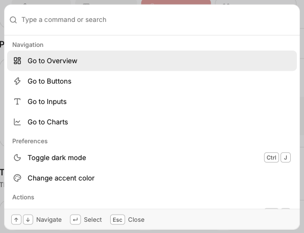

# Command palette

Use a command palette for searchable actions across the application. Available in **GUI**.



## Example

```pascal
unit Docs.Ui.Overlays.CommandPalette;

uses Fpas.Ui.Elements as E,
  Fpas.Ui.Widgets.Overlays.CommandPalettes as W;

// Builds the command palette example.
// ## Parameters
// - `Base`: The view below the overlay.
// - `Open`: Current visibility from the application model.
// ## Returns
// The widget for the application view.
public function View(Base: E.Element<string>; Open: bool): E.Element<string>;
begin
  return W.CommandPalette<string>('commands', Base, Open, [
    new W.Command<string>('Go to Overview', 'overview', Group := 'Navigation'),
    new W.Command<string>('Toggle dark mode', 'theme', Group := 'Preferences')
  ], function(Visible: bool): string => if Visible then 'open-commands' else 'close-commands' end if);
end function;

end unit;
```

## Options and defaults

| Option | Default or requirement |
| --- | --- |
| `Commands` | Each entry has a title and a message. Icon, group and shortcut hint default to empty. |
| `UseShortcut` | true. Enables the native primary-modifier+K shortcut. |

## Interaction

Type to filter commands, use Up or Down to move the highlight and press Enter to select. Escape dismisses the palette. Selection sends both a close proposal and the command message. The application owns visibility. The host restores focus after dismissal.

## See also

- [Widget API and types](../../../src/Fpas.Ui/Widgets/Overlays/CommandPalettes.fpas)
- [Gallery example](../../../examples/ui/gui/gallery/App/Palette.fpas)
- [Overlays](README.md)
