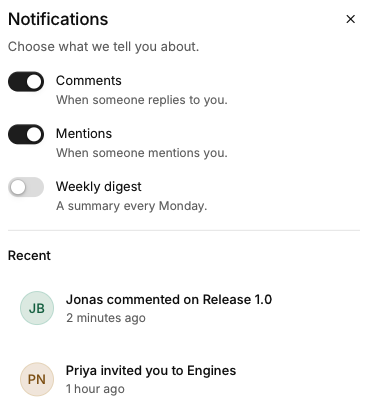
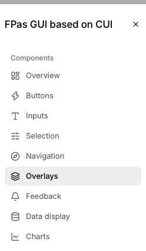

# Sheet and drawer

Use a sheet to open a modal panel from a window edge. The gallery uses a right sheet for Notifications and a left sheet as its compact navigation drawer. Available in **GUI and TUI**.





## Example

```pascal
unit Docs.Ui.Overlays.Sheet;

uses Fpas.Ui.Elements as E,
  Fpas.Ui.Widgets.Overlays.Sheets as W;

// Builds the sheet and drawer example.
// ## Parameters
// - `Base`: The view below the overlay.
// - `Open`: Current visibility from the application model.
// ## Returns
// The widget for the application view.
public function View(Base: E.Element<string>; Open: bool): E.Element<string>;
begin
  return W.Sheet<string>('notifications', Base, E.Text<string>('Notification preferences'), Open,
    new W.Options('Notifications', Description := 'Choose what we tell you about.'),
    'close-notifications');
end function;

end unit;
```

## Options and defaults

| Option | Default or requirement |
| --- | --- |
| `Title / Description` | Title is required. Description defaults to empty. |
| `Edge / Size` | Right / 400. Use Left, Top or Bottom for other edges. Size is the width for horizontal placement or the height for vertical placement. |
| `InitialFocus` | null. The close button is the fallback focus target. |

## Interaction

The body scrolls beneath the pinned header while focus stays inside. The close button, backdrop and Escape propose dismissal. A focused editor gets Escape first. The host restores the previous focus when the model closes the sheet. GUI animates the panel. TUI lays it out in cells and supports Page Up and Page Down when the focused control leaves those keys available.

## See also

- [Widget API and types](../../../src/Fpas.Ui/Widgets/Overlays/Sheets.fpas)
- [Gallery example](../../../examples/ui/gui/gallery/Pages/Overlays/Widgets/Notifications.fpas)
- [Sidebar navigation](../navigation/sidebar.md)
- [Overlays](README.md)
