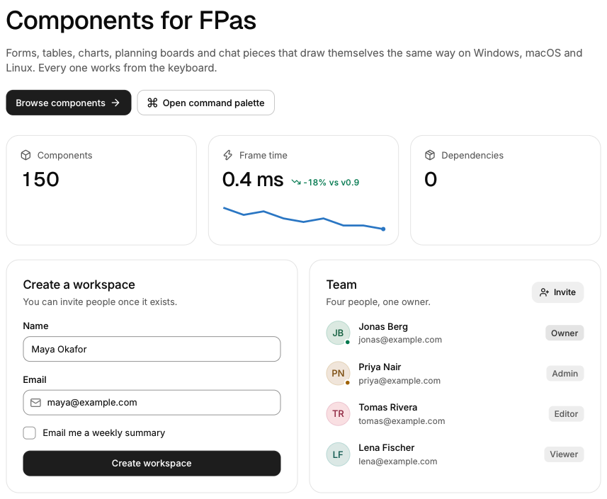

# Overview

Overview opens with an introduction and two actions, followed by a row of
metrics, a workspace form and a team card. Browse components opens Buttons.
Open command palette opens the same searchable command list as on the
Overlays page.

| Example | Widget pages |
| --- | --- |
| Components, Frame time and Dependencies | [Metric](metric.md), [Grid](../feedback/grid.md) |
| Create a workspace | [Workspace form](workspace-form.md), [Card](../feedback/card.md) |
| Team | [Card](../feedback/card.md), [Avatar](../disclosure/avatar.md), [Badge](../feedback/badge.md) |
| Browse components and Open command palette | [Button](../actions/button.md), [Command palette](../overlays/command-palette.md) |

The cards use two columns while both fit. When space runs out, Grid puts
the Team card beneath the form. The Team card uses presence dots for the
avatars and role badges for Owner, Admin, Editor and Viewer.

## See also

- [UI handbook](../README.md)
- [Sidebar appearance controls](../navigation/sidebar.md#appearance-controls)
- [Overview in the gallery](../../../examples/ui/gui/gallery/Pages/Overview/View.fpas)
- [Team card in the gallery](../../../examples/ui/gui/gallery/Pages/Overview/Widgets/Team.fpas)
