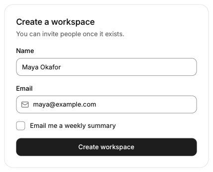

# Workspace form

Overview combines a card, two text fields, a checkbox and a primary button.
The name and email also appear on Inputs and in Edit profile.



## Example

```pascal
unit Docs.Ui.Overview.WorkspaceForm;

uses
  Fpas.Ui.Elements as E, Fpas.Ui.Layout as L, Fpas.Ui.Styles as S,
  Fpas.Ui.Widgets.Containers.Cards as Card, Fpas.Ui.Widgets.Inputs.TextFields as F,
  Fpas.Ui.Widgets.Inputs.Checkboxes as C, Fpas.Ui.Widgets.Actions.Buttons as B;

// Messages from the workspace form.
public type Msg = variant
  // Updates the shared profile name.
  SetName(Value: string);
  // Updates the shared profile email.
  SetEmail(Value: string);
  // Updates the weekly summary preference.
  SetSummary(Value: bool);
  // Activates the workspace preview.
  Create;
end variant;

// Builds the workspace form using model-owned values.
// ## Parameters
// - `Name`: Current profile name.
// - `Email`: Current profile email.
// - `WeeklySummary`: Whether weekly summaries are enabled.
// ## Returns
// A card with typed edit and submit messages.
public function View(Name: string; Email: string; WeeklySummary: bool): E.Element<Msg>;
begin
  return Card.Card<Msg>('workspace', [
    E.Styled<Msg>(E.Text<Msg>('Create a workspace'), S.Role.Heading),
    F.TextField<Msg>('workspace-name', Name, Msg.SetName,
      new F.Options(Label := 'Name', Placeholder := 'Your name', MaxUtf8Bytes := 63)),
    F.TextField<Msg>('workspace-email', Email, Msg.SetEmail,
      new F.Options(Label := 'Email', Placeholder := 'you@example.com', MaxUtf8Bytes := 95)),
    C.Checkbox<Msg>('workspace-summary', 'Email me a weekly summary',
      WeeklySummary, Msg.SetSummary),
    B.Button<Msg>('workspace-create', 'Create workspace', Msg.Create,
      new B.Options(Variant := S.ButtonVariant.Primary, Width := L.Extent.Fill))
  ], new Card.Options(Gap := 16.0F));
end function;

end unit;
```

## Interaction

Route name and email changes to the shared profile model. The weekly
summary preference belongs to the Overview model. In the gallery,
Create workspace displays a success toast as a preview.

## See also

- [Card](../feedback/card.md)
- [Text field](../inputs/text-field.md)
- [Checkbox](../selection/checkbox.md)
- [Button](../actions/button.md)
- [Toast](../overlays/toast.md)
- [Gallery example](../../../examples/ui/gui/gallery/Pages/Overview/Widgets/Workspace.fpas)
- [Gallery update](../../../examples/ui/gui/gallery/Pages/Overview/Update.fpas)
- [Overview](README.md)
