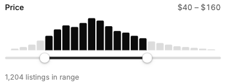

# Histogram slider

Use a histogram slider to show a data distribution behind two range handles. Available in **GUI**.



## Example

```pascal
unit Docs.Ui.Pickers.HistogramSlider;

uses Fpas.Ui.Elements as E, Fpas.Ui.Widgets.Inputs.HistogramSliders as W,
  Fpas.Ui.Widgets.Inputs.RangeSliders as R;

// Builds the histogram slider example.
// ## Parameters
// - `Price`: Current value from the application model.
// ## Returns
// The widget for the application view.
public function View(Price: R.Interval): E.Element<R.Interval>;
begin
  return W.HistogramSlider<R.Interval>('picker-price', 'Price',
    [4.0F, 13.0F, 28.0F, 35.0F, 18.0F, 6.0F], Price, 0.0F, 240.0F,
    function(Value: R.Interval): R.Interval => Value, new W.Options(Prefix := '$'));
end function;

end unit;
```

## Options and defaults

| Option | Default or requirement |
| --- | --- |
| `Bins` | A nonempty array of finite, nonnegative bin heights in range order. |
| `Value / Minimum / Maximum` | An ordered RangeSliders.Interval inside finite, increasing bounds. |
| `Height` | 0 selects CUI's default bar height. |
| `DecimalPlaces` | 0. Accepts 0 through 6. |
| `Prefix / Suffix / Enabled` | Empty / empty / true. Affixes appear in each endpoint caption. |

## Interaction

Drag either handle to change its endpoint. Focus the slider and press Space to switch the active handle for keyboard adjustment. The callback delivers both endpoints together. Compute any result count in the application from the accepted interval.

## See also

- [Widget API and types](../../../src/Fpas.Ui/Widgets/Inputs/HistogramSliders.fpas)
- [Gallery example](../../../examples/ui/gui/gallery/Pages/Pickers/Widgets/RulerAndHistogram.fpas)
- [Range slider](../selection/range-slider.md)
- [Pickers](README.md)
