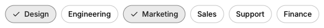

# Chip

Use chips for independently selected categories. The gallery places them in a row that wraps when space runs out. Available in **GUI**.



## Example

```pascal
unit Docs.Ui.Selection.Chip;

uses Fpas.Ui.Elements as E, Fpas.Ui.Widgets.Inputs.Chips as C;

// Builds the chip example.
// ## Parameters
// - `Selected`: Current value from the application model.
// ## Returns
// The widget for the application view.
public function View(Selected: bool): E.Element<bool>;
begin
  return C.Chip<bool>('category-design', 'Design', Selected, function(Value: bool): bool => Value);
end function;

end unit;
```

## Options and defaults

| Option | Default or requirement |
| --- | --- |
| `Selected` | Pass the current Boolean from the model. |
| `Icon` | Empty. An optional CUI icon appears while the chip is unselected. |
| `Enabled` | true. |

## Interaction

Click or press Enter or Space to propose toggling the chip. CUI draws a check mark when selected. Keep a separate value for each independent chip.

## See also

- [Widget API and types](../../../src/Fpas.Ui/Widgets/Inputs/Chips.fpas)
- [Gallery example](../../../examples/ui/gui/gallery/Pages/Selection/Widgets/Chip.fpas)
- [Selection](README.md)
