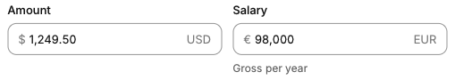

# Money field

The gallery shows a dollar amount with cents and a whole-euro salary.
Available in **GUI**.



## Example

```pascal
unit Docs.Ui.SmartInputs.MoneyField;

uses Fpas.Ui.Elements as E, Fpas.Ui.Widgets.Inputs.MoneyFields as W;

// Displays a whole-euro salary field.
// ## Parameters
// - `Salary`: Current finite amount fitting the grouped display.
// ## Returns
// A field that sends proposed amounts.
public function View(Salary: double): E.Element<double>;
requires Salary >= -double.MaxValue and Salary <= double.MaxValue;
begin
  return W.MoneyField<double>('salary', Salary,
    function(Proposed: double): double => Proposed,
    new W.Options(Label := 'Salary', Symbol := '€', Code := 'EUR',
      DecimalPlaces := 0, Hint := 'Gross per year'));
end function;

end unit;
```

## Options and defaults

| Option | Default or requirement |
| --- | --- |
| `Value` | A finite double. The grouped display must fit in 63 bytes. |
| `Label / Hint` | Empty. Shown above and below the field. |
| `Symbol / Code` | $ / empty. These are literal captions. |
| `DecimalPlaces` | 2. Accepts 0 to 15 fractional digits. |
| `Width / Enabled` | Content / true. |

## Interaction

CUI groups digits with commas at rest. While editing, use plain digits
and a decimal point. The format is independent of the current CLR culture.
Handle the proposed double in the update. If its grouped display would
exceed the native capacity, the widget retains the previous value.

## See also

- [Widget API and types](../../../src/Fpas.Ui/Widgets/Inputs/MoneyFields.fpas)
- [Gallery example](../../../examples/ui/gui/gallery/Pages/SmartInputs/Widgets/Editors.fpas)
- [Number field](../inputs/number-field.md)
- [Smart inputs](README.md)
