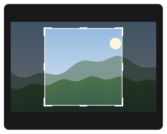

# Image cropper

The gallery previews a square crop on the same landscape as the viewer.
Available in **GUI**.



## Example

```pascal
unit Docs.Ui.SocialAndMedia.ImageCropper;

uses Fpas.Ui.Elements as E, Fpas.Ui.Widgets.Media.ImageCroppers as W, Fpas.Ui.Widgets.Media.MediaImages as M, Fpas.Ui.Layout as L;

// Edits a square crop in source-image coordinates.
// ## Parameters
// - `Picture`: Local file or immutable RGBA image.
// - `Crop`: Current rectangle in image pixels.
// ## Returns
// The cropper with its proposed rectangle as a message.
public function View(Picture: M.Source; Crop: W.Value): E.Element<W.Value>;
begin
  return W.ImageCropper<W.Value>('crop', Picture, Crop,
    function(Change: W.Value): W.Value => Change,
    new W.Options(Height := L.Extent.Fixed(L.Measure.Logical(260)), Aspect := 1.0F));
end function;

end unit;
```

## Options and defaults

| Option | Default or requirement |
| --- | --- |
| `Value.X / Y / Width / Height` | All zero. A zero size requests the native initial crop. |
| `Aspect / Round / MinimumSize` | 0 / false / 0. Zero Aspect permits free sizing. Round draws a circular mask and keeps a square selection. |
| `Width / Height / Enabled` | Content / Content / true. |

## Interaction

Drag the selection or pull its handles. Store the new rectangle. Use its
coordinates to crop or export the source in your application.

## See also

- [Widget API and types](../../../src/Fpas.Ui/Widgets/Media/ImageCroppers.fpas)
- [Gallery example](../../../examples/ui/gui/gallery/Pages/Social/Media.fpas)
- [Social and media](README.md)
