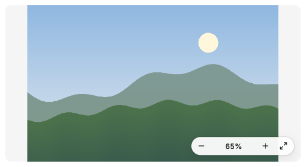

# Image viewer

The gallery shows a landscape with native zoom controls and pointer-centered zoom.
Available in **GUI**.



## Example

```pascal
unit Docs.Ui.SocialAndMedia.ImageViewer;

uses Fpas.Ui.Elements as E, Fpas.Ui.Widgets.Media.ImageViewers as W, Fpas.Ui.Widgets.Media.MediaImages as M, Fpas.Ui.Layout as L;

// Shows an image at the current zoom and center.
// ## Parameters
// - `Picture`: Local file or immutable RGBA image.
// - `Current`: Model-owned zoom and center.
// ## Returns
// The viewer with proposed pan and zoom as messages.
public function View(Picture: M.Source; Current: W.Value): E.Element<W.Value>;
begin
  return W.ImageViewer<W.Value>('landscape', Picture, Current,
    function(Change: W.Value): W.Value => Change,
    new W.Options(Height := L.Extent.Fixed(L.Measure.Logical(260))));
end function;

end unit;
```

## Options and defaults

| Option | Default or requirement |
| --- | --- |
| `Zoom / CenterX / CenterY` | All zero. Zero Zoom fits the image. Positive Zoom gives logical points per image pixel. Centers are image coordinates. |
| `Width / Height / MaximumZoom` | Content / Content / 0. Zero MaximumZoom uses the native maximum. |
| `HideToolbar / Checkerboard / Enabled` | false / false / true. |

## Interaction

Use the wheel to zoom around the pointer and drag to pan. Double-click
switches from fit or a zoom below 100 percent to 100 percent; otherwise it
fits the image. Store the proposed value. To request fit from the
application, set Zoom to zero.

## See also

- [Widget API and types](../../../src/Fpas.Ui/Widgets/Media/ImageViewers.fpas)
- [Gallery example](../../../examples/ui/gui/gallery/Pages/Social/Media.fpas)
- [Image cropper](image-cropper.md)
- [Social and media](README.md)
