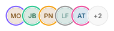

# Presence

Use presence to show who's in a conversation. The gallery overlaps the
avatars and displays a count for participants outside the visible limit.
Available in **GUI**.



## Example

```pascal
unit Docs.Ui.SocialAndMedia.Presence;

uses Fpas.Ui.Elements as E, Fpas.Ui.Widgets.Conversation.Presences as W;

// Shows the people present in a conversation.
// ## Parameters
// - `Users`: People in display order.
// ## Returns
// The native presence display.
public function View(Users: array of W.User): E.Element<string>;
begin
  return W.Presence<string>('conversation-users', Users);
end function;

end unit;
```

## Options and defaults

| Option | Default or requirement |
| --- | --- |
| `User.Name / Avatar` | Pass a name for initials and the hover label. An avatar file is optional. |
| `User.Color / Idle` | Automatic / false. Idle shows the user as away. |
| `MaximumVisible / Size` | 5 / 30 logical points. |

## Interaction

Hover to spread the avatars. Update the supplied list as people join,
leave or go idle.

## See also

- [Widget API and types](../../../src/Fpas.Ui/Widgets/Conversation/Presences.fpas)
- [Gallery example](../../../examples/ui/gui/gallery/Pages/Social/View.fpas)
- [Presence pill](../canvas-and-bars/presence-pill.md)
- [Social and media](README.md)
