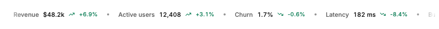

# Ticker

The gallery scrolls revenue, activity, churn, latency and other example figures.
Available in **GUI**.



## Example

```pascal
unit Docs.Ui.SocialAndMedia.Ticker;

uses Fpas.Ui.Elements as E, Fpas.Ui.Widgets.Feedback.Tickers as W;

// Shows the current figures.
// ## Parameters
// - `Figures`: Labels, values and optional percent changes.
// ## Returns
// The native scrolling ticker.
public function View(Figures: array of W.Item): E.Element<string>;
begin
  return W.Ticker<string>('figures', Figures);
end function;

end unit;
```

## Options and defaults

| Option | Default or requirement |
| --- | --- |
| `Item.Value / Delta / LowerIsBetter` | Empty / 0 / false. Zero Delta hides the trend. LowerIsBetter gives decreases the success color. |
| `Speed / Height` | Both zero. Positive Speed uses logical points per second. Zero Height uses native sizing. |

## Interaction

Hover over the ticker to pause it. Replace the list when your data changes.
The ticker renders the supplied figures.

## See also

- [Widget API and types](../../../src/Fpas.Ui/Widgets/Feedback/Tickers.fpas)
- [Gallery example](../../../examples/ui/gui/gallery/Pages/Social/View.fpas)
- [Social and media](README.md)
