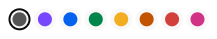
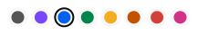

# Interactive canvas

The gallery draws eight selectable swatches. The ring marks the current choice.
Available in **GUI**.



## Example

```pascal
unit Docs.Ui.TextAndDisplay.Canvas;

uses
  Fpas.Ui.Elements as E, Fpas.Ui.Graphics as G, Fpas.Ui.Layout as L,
  Fpas.Ui.Widgets.Canvas.Canvases as W;

// Draws a swatch and reports the click in canvas coordinates.
// ## Parameters
// - `Fill`: Swatch color.
// ## Returns
// A 22-point square canvas with a circle.
public function View(Fill: G.Color): E.Element<W.Event>;
begin
  const Size: L.Extent := L.Extent.Fixed(L.Measure.Logical(22));
  return W.Canvas<W.Event>('color-swatch',
    [W.Shape.Circle(11.0F, 11.0F, 8.0F, Fill)],
    function(Click: W.Event): W.Event => Click,
    new W.Options(Width := Size, Height := Size));
end function;

end unit;
```

## Options and defaults

| Option | Default or requirement |
| --- | --- |
| `Width / Height / Enabled` | Fill / 120 logical points / true. |
| `Drawing` | Rectangles, circles and lines in paint order. |

## Interaction

The click message carries the pointer position and canvas size in local
logical points. In the gallery, each swatch maps its click to a selection
index. The update stores that index and the next view draws its ring.



## See also

- [Widget API and types](../../../src/Fpas.Ui/Widgets/Canvas/Canvases.fpas)
- [Gallery example](../../../examples/ui/gui/gallery/Pages/Display/View.fpas)
- [Canvas and bars](../canvas-and-bars/README.md)
- [Chapter index](README.md)
