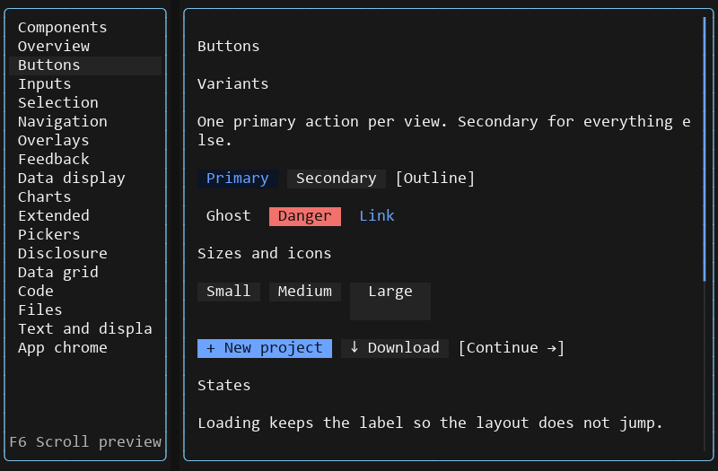

# Button

Run a command such as saving the current draft.



## Example

```pascal
unit Docs.Tui.Actions.Button;

uses Fpas.Ui.Elements as E, Fpas.Ui.Widgets.Actions.Buttons as B, Fpas.Ui.Styles as S;

// Builds the button example.
// ## Returns
// The control for this view.
public function View(): E.Element<string>;
begin
  return B.Button<string>('add', 'Add track', 'add', new B.Options(Variant := S.ButtonVariant.Primary));
end function;

end unit;
```

## Interaction

Tab to the button and press Enter or Space, or click it. Set `Enabled := false` when the action is unavailable. The button keeps its ID when the caption changes.

## See also

- [Actions](README.md)
- [Shared API](../../widgets.md#button)
- [GUI button](../../gui/actions/button.md)
