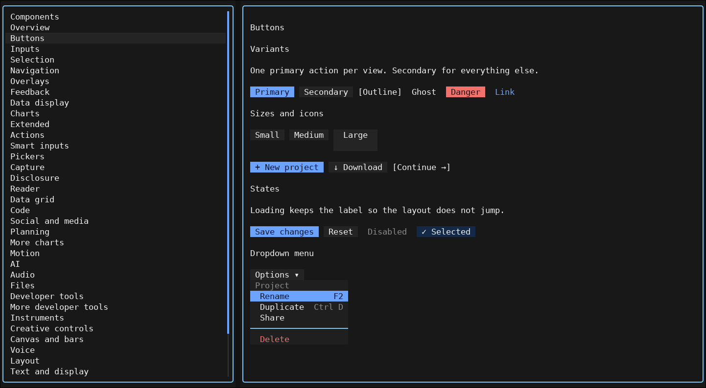

# Dropdown menu

Group commands behind one button. The **Options** example under **Components → Buttons → Dropdown menu** shares the GUI gallery's **Rename**, **Duplicate**, **Share** and **Delete** commands. Delete opens the project confirmation dialog.



## Example

```pascal
unit Docs.Tui.Actions.DropdownMenu;

uses Fpas.Ui.Elements as E;
uses Fpas.Ui.Widgets.Overlays.Menus as Menu;

// Builds the project command menu.
// ## Returns
// A dropdown that sends the chosen command as an application message.
public function View(): E.Element<string>;
begin
  return Menu.Menu<string>('options', 'Options', [
    Menu.Entry<string>.Label('Project'),
    Menu.Entry<string>.Action(new Menu.Item<string>('rename', 'Rename', 'rename')),
    Menu.Entry<string>.Separator,
    Menu.Entry<string>.Action(new Menu.Item<string>('delete', 'Delete', 'confirm-delete', Danger := true))
  ]);
end function;

end unit;
```

## Interaction

Enter, Down or a click opens the menu. Up and Down move between enabled commands, skipping section labels and separators. Home and End jump to the first and last enabled command. Enter or a click runs the command. Escape or an outside click closes the popup and restores focus to the button.

The panel is anchored to the button and fits within the terminal. Menus show shortcut hints, check marks and danger colors. To make a hint usable as a key binding, bind the shortcut in the application. Icon-only triggers use the terminal ellipsis and retain their accessible label.

The trigger has snapshot role `menu`. Its value reports whether it is open. A visible `menu-item` uses `Menu.ItemId(Id, Key)` and its value reports the highlight. Disabled entries stay visible and skip keyboard focus.

## See also

- [Terminal actions](README.md)
- [Shared API and GUI gallery](../../gui/actions/dropdown-menu.md)
- [Popup input and focus](../host.md#popup-input)

## Source files

- [Dropdown trigger and rows](../../../../src/Fpas.Ui.Tui/Internal/Widgets/Overlays/Dropdown.fpas)
- [Headless dropdown contract](../../../../tests/Fixtures/tui/Dropdown.fpas)
