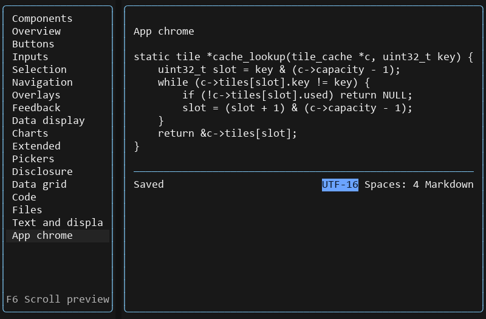

# Status bar

Place short pieces of state and small actions along the bottom of a pane. A spacer pushes trailing items to the right.



## Example

```pascal
unit Docs.Tui.Widgets.StatusBar;

uses Fpas.Ui.Elements as E, Fpas.Ui.Widgets.Desktop.StatusBars as W;

// Builds the status bar example.
// ## Parameters
// - `Encoding`: Current document encoding.
// ## Returns
// The resulting view.
public function View(Encoding: string): E.Element<string>;
begin
  return W.StatusBar<string>('status', [
    W.Item<string>.Text(new W.Label('Saved')), W.Item<string>.Spacer,
    W.Item<string>.Action('encoding', new W.Label(Encoding), 'Change encoding', true, 'encoding')
  ], true);
end function;

end unit;
```

## Interaction

Tab to the encoding and press Enter or click to change it. Text, spacers and inline progress do not take focus. Place a growing content area above the bar to keep it at the bottom as the terminal resizes.

## See also

- [App chrome](README.md)
- [Shared API](../../widgets.md#desktop-chrome)
- [GUI status bar](../../gui/app-chrome/status-bar.md)
- [Gallery source](../../../../examples/ui/tui/gallery/main.fpas)

## Source files

- [StatusBar.fpas](../../../../src/Fpas.Ui.Tui/Internal/Widgets/Desktop/StatusBar.fpas)
