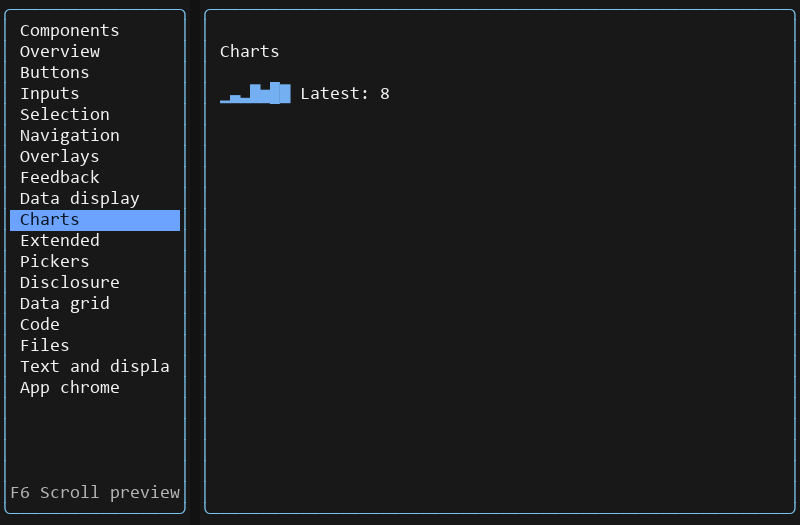

# Sparkline

The **Components → Charts** page plots the CUI sequence
`3, 5, 4, 8, 6, 9, 8` and reports the latest value next to it.

Use `Sparklines.Sparkline` to show how a finite series changes over time or
another ordered dimension. A single terminal row provides eight levels. The
sparkline scales relative to the smallest and largest sample. Constant
series use a middle level, and empty series leave the plot blank.

Natural width uses one column per sample when space permits. Fixed and
fill widths interpolate the values across the allocated columns. The graphical
host uses the logical height.
`Color` takes a theme series or an explicit color. The plot has no focus stop.

## See also

- [Shared API](../../widgets.md#charts)
- [GUI sparkline](../../gui/charts/sparkline.md)

## Source files

- [Sparkline.fpas](../../../../src/Fpas.Ui.Tui/Internal/Widgets/Charts/Sparkline.fpas)
- [PlotSamples.fpas](../../../../examples/ui/tui/gallery/PlotSamples.fpas)
