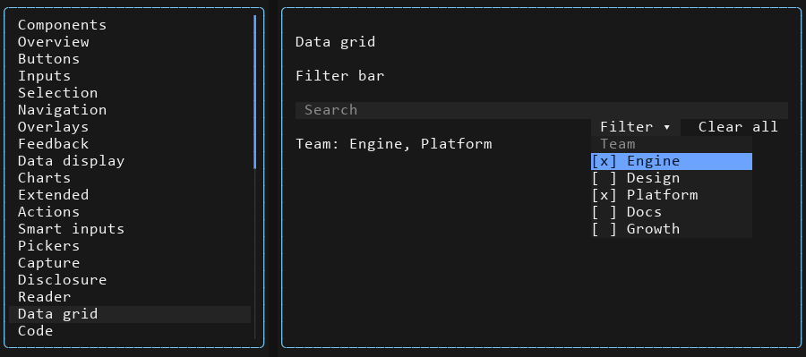

# Filter bar

Use `Fpas.Ui.Widgets.Collections.FilterBars.FilterBar` to collect search text
and multiple selected values per field. In **Extended → Data grid**, the
terminal and CUI galleries share **Team**, **Status**, and **Role**. Team starts
with **Engine** and **Platform** selected.

## Interaction

| Control | Keyboard and pointer |
| --- | --- |
| Search | Tab into the field, then type, edit or paste text. |
| Filter | Enter, Space or a click opens the field menu. Up and Down move the highlight. Enter, Space or a click opens the highlighted field. |
| Field values | Up and Down move through the values. Space, Enter or a click toggles a value and keeps the menu open. Home, End, Page Up and Page Down move through longer menus. |
| Dismissal | Escape, Tab or a click outside closes the menu and returns focus to Filter when available. |
| Clear all | Clears all choices and any search text. |

The bar lists the current choices beneath its actions. The application owns
the search text and one unsigned mask per field. Bit zero selects the first
value. Zero clears the field. Accept `OnChange` in the application update to
show a proposed change and apply it to the data. The gallery illustrates the
filter state directly.

Pass null for `Value.Search` to omit the editor, or an empty string to show
it blank. Search takes a single line. Its UTF-8 capacity includes one byte for
the terminator. `Enabled := false` disables the search and actions.

The terminal exposes `<id>/search`, `<id>/add` and `<id>/clear` when those controls
are present. Open menu entries use zero-based IDs such as
`<id>/add/field/1/value/0`. The `filter-value` snapshot reports checked state
as `true` or `false`.

## See also

- [Data display](README.md)
- [Shared API and CUI example](../../gui/data-grid/filter-bar.md)
- [Terminal gallery](../../../../examples/ui/tui/gallery/README.md)

## Source files

- [Terminal filter bar](../../../../src/Fpas.Ui.Tui/Internal/Widgets/Collections/FilterBar.fpas)
- [Headless filter contract](../../../../tests/Fixtures/tui/FilterBar.fpas)
