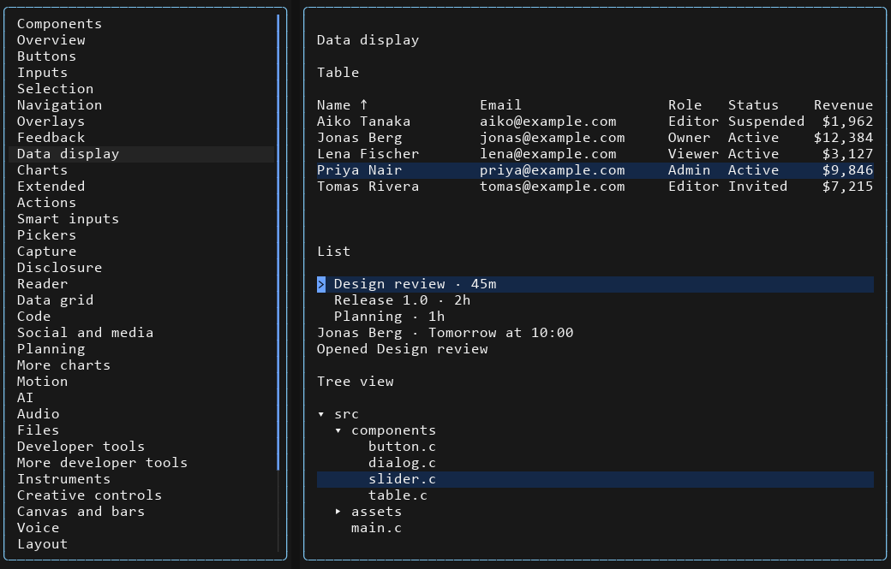

# Selection list

Use `Fpas.Ui.TerminalExtensions.SelectionLists.SelectionList` to browse and
activate entries in a terminal panel. **Components → Data display → List**
uses the original CUI rows **Design review**, **Release 1.0** and **Planning**,
with the same titles, people, subtitles, durations and initial selection.

Each item supplies a key, a one-line caption and an optional `CanActivate`
flag. Keys are nonempty and unique within the list. Pass the current key from
the model, or an empty string for no selection. Use `Elements.Size` with a
fixed or flexible height to bound the list viewport.

## Interaction

The list occupies one tab stop. Up, Down, Home, End, Page Up, Page Down and
left clicks propose a new key through `OnSelect`. Accepted selection changes
scroll into view. The wheel scrolls the viewport independently of the
selection. Enter invokes `OnActivate` for the model's current key when its item
allows activation. Items with `CanActivate := false` remain selectable so the
view can show their details. An empty list is skipped by Tab.

In the gallery, moving through the list shows each person's name and subtitle.
Press Enter to show which entry was opened. You can inspect another entry
while the last opened entry remains visible.

Headless snapshots expose the control's ID, the role `listbox` and the selected
key as its value. `Application.Input.Activate(Id)` follows the Enter behavior.
The terminal capability profile is required.

## See also

- [Data display](README.md)
- [CUI list item and shared sample data](../../gui/data-display/list-item.md)
- [Select input](../inputs/select.md)
- [Terminal gallery](../../../../examples/ui/tui/gallery/README.md)

## Source files

- [Selection list contract](../../../../src/Fpas.Ui/TerminalExtensions/SelectionLists.fpas)
- [Terminal rendering and interaction](../../../../src/Fpas.Ui.Tui/Internal/Widgets/Collections/SelectionList.fpas)
- [Terminal gallery list example](../../../../examples/ui/tui/gallery/ListSample.fpas)
- [Headless list contract](../../../../tests/Fixtures/tui/SelectionList.fpas)
