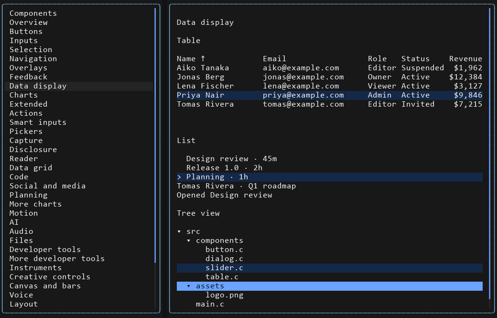

# Tree

Use `Fpas.Ui.Widgets.Collections.Trees.Branch` and `Trees.Leaf` to display
a hierarchy. **Components → Data display** uses the same source file tree
as the graphical gallery. Keep node IDs stable while changing expansion or
selection in the application model.

Tab enters the tree. Up and Down move through visible enabled nodes, with
Home, End, Page Up and Page Down for longer trees. Left collapses an open
branch or moves from a child to its parent. Right expands a closed branch.
Enter, Space or a click activates a file or toggles a branch. Wrap a long
tree in a [scroll view](../layout/scroll-view.md) to keep the keyboard
destination visible.

## Source files

- [Terminal tree rows](../../../../src/Fpas.Ui.Tui/Internal/Widgets/Collections/TreeRows.fpas)
- [Shared gallery tree](../../../../examples/ui/gui/gallery/Shared/SourceTree.fpas)
- [Graphical tree and shared API](../../gui/data-display/tree.md)
