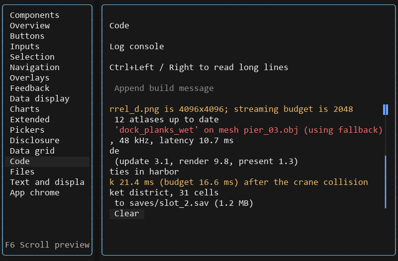

# Log console

`Fpas.Ui.Widgets.Developer.LogConsoles.LogConsole` shows entries in arrival
order. Under **Extended → Code**, both galleries use the same build messages.
**Append build message** reveals the next entry from the same original log.

Each entry occupies one row, with a severity label and optional timestamp.
The console follows new messages while the last entry is visible. When you
scroll back, it keeps the first visible entry in place as the application
appends more entries.

Use the wheel or focus the console and use Up, Down, Page Up, Page Down,
Home and End. End returns to the newest message. Use Ctrl+Left and Ctrl+Right
to read across long messages. With the toolbar enabled,
Clear sends the supplied message so the application can clear its entries.

## Source files

- [Terminal log console](../../../../src/Fpas.Ui.Tui/Internal/Widgets/Developer/LogConsole.fpas)
- [Graphical log console and shared API](../../gui/code/log-console.md)
- [Gallery example](../../../../examples/ui/tui/gallery/ToolSamples.fpas)
