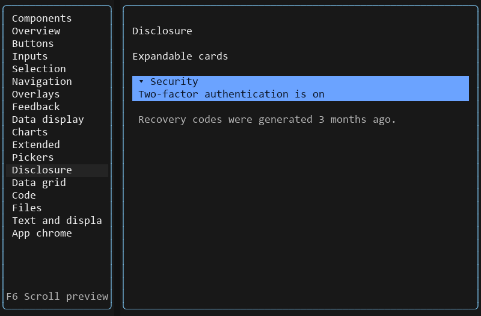

# Expandable card

Keep a summary visible while showing details on demand. Under **Extended → Disclosure → Expandable cards**, the **Security** example uses the same summary and recovery-code details in both galleries.



## Example

```pascal
unit Docs.Tui.Disclosure.ExpandableCard;

uses Fpas.Ui.Elements as E;
uses Fpas.Ui.Widgets.Containers.ExpandableCards as Cards;

// Builds a card whose expansion state is owned by the model.
// ## Parameters
// - `Expanded`: Whether the details are visible.
// ## Returns
// A card that proposes the next expansion state.
public function View(Expanded: bool): E.Element of bool;
begin
  return Cards.ExpandableCard of bool('security', 'Security', Expanded,
    function(Value: bool): bool => Value, E.Text of bool('Recovery codes are available.'),
    new Cards.Options(Description := 'Two-factor authentication is on'));
end function;

end unit;
```

## Interaction

Tab focuses the header. Enter, Space or a click proposes the opposite expansion state. The header keeps its focus and shows `▸` when closed and `▾` when open. Tab can reach controls in the open body. If the model closes the card while focus is in the body, focus returns to the header.

The description appears below the title and shares its hit target. The terminal shows badges as text in brackets. Disabling an open card keeps the content visible and makes its header and body inert. The header exposes the snapshot role `expandable-card` with value `true` or `false`.

## See also

- [Disclosure](README.md)
- [Shared API and GUI example](../../gui/disclosure/expandable-card.md)

## Source files

- [Terminal card layout](../../../../src/Fpas.Ui.Tui/Internal/Widgets/Containers/ExpandableCard.fpas)
- [Terminal focus and expansion contract](../../../../tests/Fixtures/tui/ExpandableCard.fpas)
