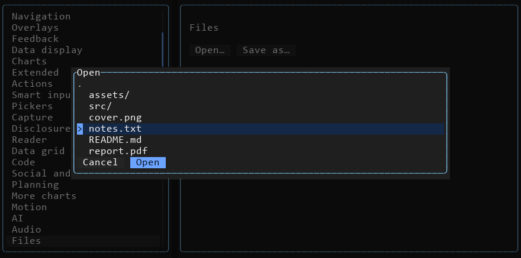
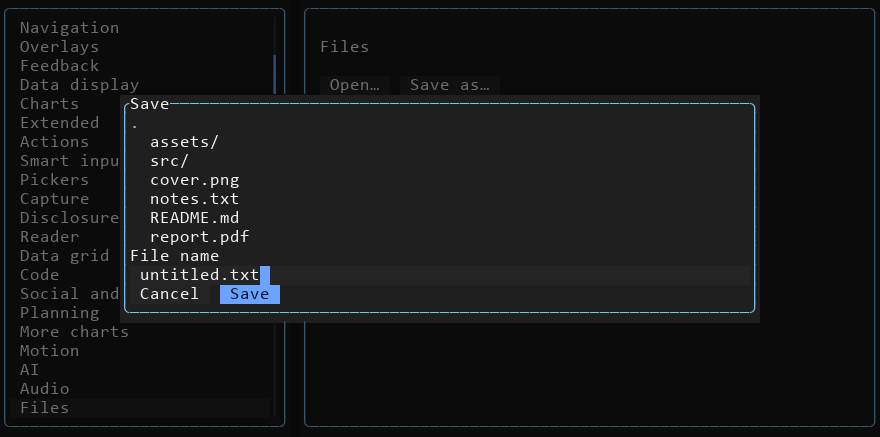

# File picker

`Fpas.Ui.Widgets.Files.FilePickers.FilePicker` presents a modal list of local
or application-provided files. The terminal gallery uses the original
**Open** and **Save as** examples under **Extended → Files**.

## Choose a path

| Mode | Behavior |
| --- | --- |
| `OpenFile` | Select an existing file. Enter or **Open** confirms a file or enters the selected folder. |
| `SaveFile` | Enter a filename or select one from the list to fill the field. Submit the field with Enter or activate **Save**. |
| `Folder` | The list shows folders. **Choose** returns the selected folder or the current folder when no child is selected. |

Use Up and Down, Page Up and Page Down, or Home and End to select a row.
The mouse selects a row and scrolls the list. Enter on a folder browses
into it. Select `../` and press Enter to go up. Tab and Shift+Tab move among
the list, filename field and buttons. Escape, **Cancel** or a click outside
the dialog returns a null path. Focus returns to the launcher after closing.

## Shared contract

Set `Open` in the application model. Handle the proposed `Event.Path` and
clear `Open` when accepting the result. Each opening starts at `Options.Start`
and uses `Options.Name` for **Save**. Folder changes, selection and typing
are local to the open dialog.

With the default source, an empty start uses the working directory and
successful choices are full local paths. With `Options.Source`, the picker
starts from the supplied path or `.` and uses the provider's directory
structure. The terminal requests listings with hidden files off. A null
listing or provider failure shows **Unable to read folder**. The parent
remains reachable when the current path has one. Backslash UNC paths stop at
the share root, including when the terminal runs on a non-Windows host.

`Options.Filter` uses case-insensitive `*` and `?` glob patterns separated
by semicolons or commas. It filters file rows while keeping directories
available for navigation. **Save** accepts a single filename within the
current folder. The application performs the actual file operation.

## See also

- [Shared API and example](../../gui/files/file-picker.md)
- [Terminal files](README.md)
- [Terminal gallery](../../../../examples/ui/tui/gallery/README.md#file-picker)

## Source files

- [Terminal file picker](../../../../src/Fpas.Ui.Tui/Internal/Widgets/Files/FilePicker.fpas)
- [Directory listings and path rules](../../../../src/Fpas.Ui.Tui/Internal/Widgets/Files/FilePickerListing.fpas)
- [Session-local picker state](../../../../src/Fpas.Ui.Tui/Internal/Widgets/Files/FilePickerState.fpas)
- [Headless file picker contract](../../../../tests/Fixtures/tui/FilePicker.fpas)
