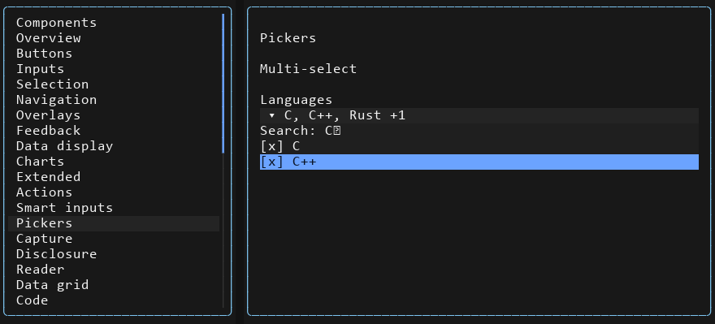

# Multi-select

Use `Fpas.Ui.Widgets.Inputs.MultiSelects.MultiSelect` to choose several
values from one list. Under **Extended → Pickers**, the terminal gallery
shows the original CUI **Languages** example with **C**, **Rust** and
**Swift** selected initially.

## Interaction

Tab to the field. Enter, Space, Down or a click opens the checklist. When
`Searchable` is enabled, type or paste to filter the options. Backspace
removes the last text element and Ctrl+A clears the query.

Up and Down move through the matching choices. Space, Enter or a click
toggles a choice and keeps the list open. When the query is empty, End
reaches **Select all** or **Clear all**. Escape or a click outside closes
the list and restores focus to the field. Reopen it to start with an empty query.

## Selection and display

Pass one Boolean per item in original list order. Every change proposes a
fresh Boolean array through `OnChange`. Accept it in the model to update
the checked values. Filtering preserves both the item indices and the
selection of hidden items.

The field shows the selected names up to `MaxChips`, which defaults to
three. It shows a `+N` count for selections beyond that limit or beyond
the available width. Open the checklist to change the selection.

Use `Selects.OptionId(Id, Index)` to identify a visible option by its
original index. Option snapshots expose `true` or `false`. The field's
snapshot value lists all selected names.

## See also

- [Terminal inputs](README.md)
- [Shared API and CUI example](../../gui/pickers/multi-select.md)
- [Single selection](select.md)

## Source files

- [Terminal multi-select](../../../../src/Fpas.Ui.Tui/Internal/Widgets/Inputs/MultiSelect.fpas)
- [Headless multi-select contract](../../../../tests/Fixtures/tui/MultiSelect.fpas)
