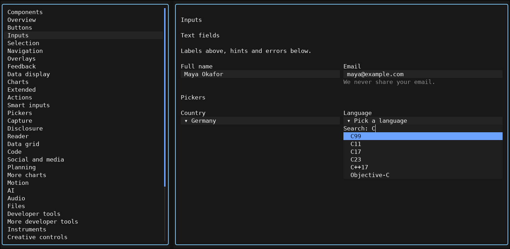

# Select

A select displays one model-owned choice in a single terminal row. Under **Components → Inputs → Pickers**, both galleries show the same **Country** list and searchable **Language** list.



## Example

```pascal
unit Docs.Tui.Inputs.Select;

uses Fpas.Ui.Elements as E;
uses Fpas.Ui.Widgets.Inputs.Selects as S;

// Builds a searchable language picker.
// ## Parameters
// - `Selected`: Original index, or -1 before a choice.
// ## Returns
// The field sends a new index to the application when a choice is committed.
public function View(Selected: int): E.Element<int>;
begin
  return S.Select<int>('language',
    [new S.Item('C99'), new S.Item('Zig'), new S.Item('Rust')],
    Selected, function(Index: int): int => Index,
    new S.Options(Label := 'Language', Placeholder := 'Pick a language', Searchable := true));
end function;

end unit;
```

## Interaction

Enter, Space or a click opens the list on the selected choice, or the first choice if none is selected. Use ↑/↓, Home/End, Page Up/Page Down or the wheel to highlight an option. Enter or a click commits it. Escape or a click outside closes the list and returns focus to the field. The popup opens above the field when there is more room there and too little room below.

With `Searchable := true`, type or paste part of a label to filter without regard to case. Backspace removes the last text element. An empty result shows **No results**. Each opening starts with an empty search.

The trigger exposes the snapshot role `select` and its visible value. Each visible `select-option` uses `S.OptionId(Id, Index)` with its original index, even when filtered. Terminal options use text labels. The optional CUI icon is graphical.

## See also

- [Terminal inputs](README.md)
- [Selection list with separate selection and activation](../data-display/selection-list.md)
- [Popup input and focus](../host.md#popup-input)
- [Select API and GUI example](../../gui/inputs/select.md)

## Source files

- [Select trigger and session state](../../../../src/Fpas.Ui.Tui/Internal/Widgets/Inputs/Select.fpas)
- [Headless interaction contract](../../../../tests/Fixtures/tui/Select.fpas)
