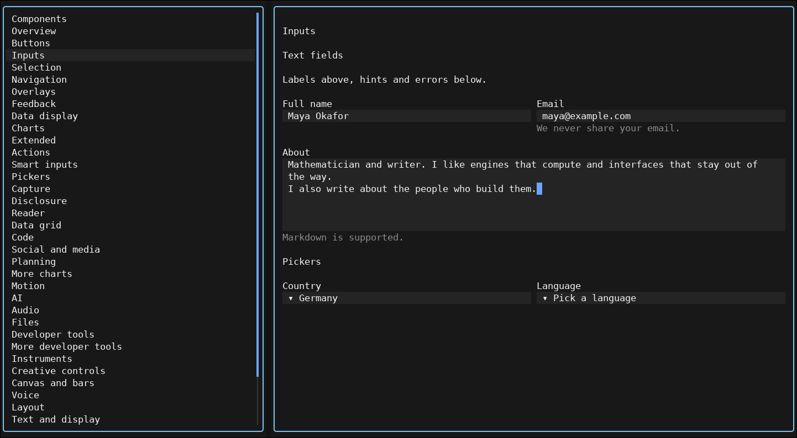

# Text area

Edit multiline text with the shared `TextAreas.TextArea` widget. The **About** field under **Components → Inputs** uses the same example in the GUI and terminal galleries.



## Example

```pascal
unit Docs.Tui.Inputs.TextArea;

uses Fpas.Ui.Elements as E, Fpas.Ui.Widgets.Inputs.TextAreas as Areas;

// Builds a profile description field.
// ## Parameters
// - `About`: Model-owned text with LF line endings, up to 511 UTF-8 bytes.
// ## Returns
// An editor that proposes changes to the description.
public function View(About: string): E.Element<string>;
begin
  return Areas.TextArea<string>('about', About, function(Value: string): string => Value,
    new Areas.Options(Label := 'About', Placeholder := 'Write a short description',
      Height := 96, MaxUtf8Bytes := 511));
end function;

end unit;
```

## Interaction

Tab focuses the area and moves on to the next control. Click to place the caret. Left and Right move one text element, Up and Down move between wrapped rows and Home and End move to the edges of the current row. Ctrl+Home and Ctrl+End move to the beginning and end of the text. Page Up and Page Down move by the editor's height.

Enter inserts LF. Paste converts CRLF and CR to LF and respects `MaxUtf8Bytes` at text-element boundaries. The model owns the accepted value. When the terminal reports Ctrl+Enter separately from Enter, it invokes the optional submit callback.

The field wraps at word boundaries when possible. The wheel scrolls the field and hands off to the enclosing scroll view at an edge. `ReadOnly` allows navigation and scrolling. `Enabled := false` removes the field from keyboard traversal.

`Height` sets the editable area in logical points, which the terminal converts to rows. Zero uses the default six rows. A negative height fills available space. A placeholder appears for empty text, and an error replaces the hint. Icons, affixes, the clear button and nondefault control sizes use the graphical profile.

## See also

- [Terminal inputs](README.md)
- [Shared API and GUI example](../../gui/inputs/text-area.md)

## Source files

- [Terminal area and rendering](../../../../src/Fpas.Ui.Tui/Internal/Widgets/Inputs/TextArea.fpas)
- [Caret, editing and scrolling](../../../../src/Fpas.Ui.Tui/Internal/Widgets/Inputs/TextAreaEditing.fpas)
- [Wrapped line geometry](../../../../src/Fpas.Ui.Tui/Internal/Widgets/Inputs/TextAreaRows.fpas)
- [Shared text-element and paste helpers](../../../../src/Fpas.Ui.Tui/Internal/Widgets/Inputs/EditText.fpas)
- [Terminal text area contract](../../../../tests/Fixtures/tui/TextArea.fpas)
