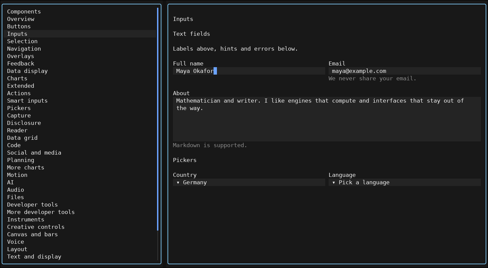
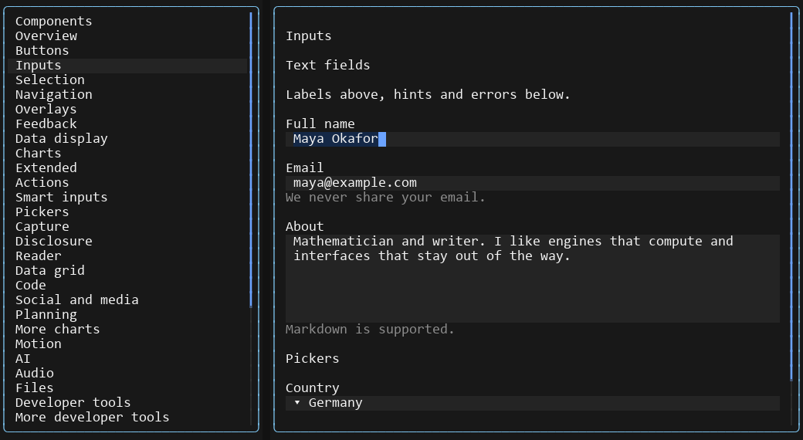

# Text field

Edit one line of model-owned text. The **Components → Inputs → Text fields** example shares its full name and email with Overview and Edit profile.



## Example

```pascal
unit Docs.Tui.Widgets.TextField;

uses Fpas.Ui.Elements as E;
uses Fpas.Ui.Widgets.Inputs.TextFields as W;

// Builds the text field example.
// ## Parameters
// - `Name`: Current full name.
// ## Returns
// The resulting view.
public function View(Name: string): E.Element of string;
begin
  return W.TextField of string('input-name', Name, function(Value: string): string => Value,
    new W.Options(Label := 'Full name', Placeholder := 'Maya Okafor', MaxUtf8Bytes := 63));
end function;

end unit;
```

## Interaction

Click to place the caret. Left/Right and Backspace/Delete move or delete by grapheme. Home/End reach the ends and the line scrolls to keep the caret visible. Paste turns line breaks into spaces and respects the UTF-8 byte limit. Enter invokes an optional `OnSubmit` with the current value. Read-only fields accept focus, disabled fields skip it. The terminal supports labels, hints, errors and the default size.

Hold Shift with the navigation keys to select text. Ctrl+A selects the
whole field. Typing or pasting replaces the selection. Backspace and Delete
remove it.



## See also

- [Inputs](README.md)
- [Shared API](../../widgets.md#text-field)
- [GUI text field](../../gui/inputs/text-field.md)
- [Gallery source](../../../../examples/ui/tui/gallery/ProfileSample.fpas)

## Source files

- [LineEditor.fpas](../../../../src/Fpas.Ui.Tui/Internal/Widgets/Inputs/LineEditor.fpas)
- [src/Fpas.Ui.Tui/Internal/Widgets/Inputs/TextField.fpas](../../../../src/Fpas.Ui.Tui/Internal/Widgets/Inputs/TextField.fpas)
- [tests/Fixtures/tui/TextField.fpas](../../../../tests/Fixtures/tui/TextField.fpas)
