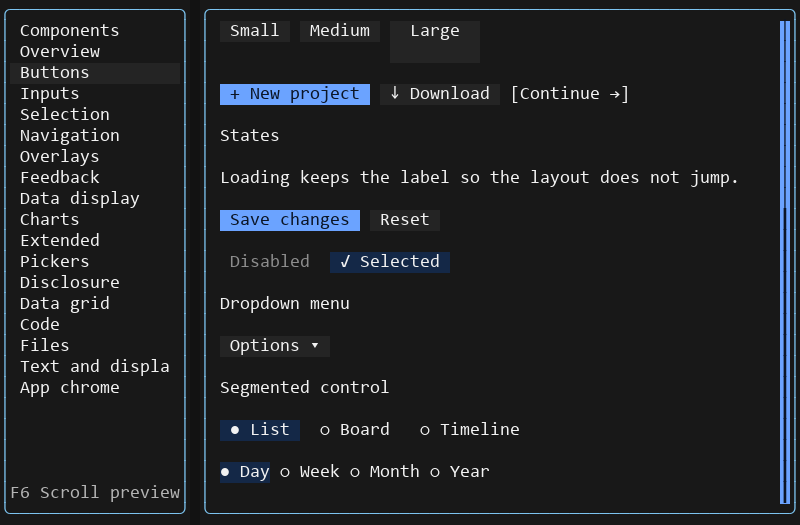

# Scroll view

Keep a long list or body inside a bounded vertical viewport. The gallery
preview scrolls independently of the sidebar. The thumb (`┃`) marks the
visible portion on the scrollbar track (`│`).



## Example

```pascal
unit Docs.Tui.Widgets.ScrollView;

uses Fpas.Ui.Elements as E;
uses Fpas.Ui.Layout as L;

// Builds the scroll view example.
// ## Parameters
// - `Items`: Rows to display.
// ## Returns
// The resulting view.
public function View(Items: array of E.Element of string): E.Element of string;
begin
  return E.Size of string(E.ScrollView of string('tracks-scroll', E.Column of string(Items)),
    new L.Flex(Basis := L.Extent.Fixed(L.Measure.Cells(8))));
end function;

end unit;
```

## Size the viewport

Put the scroll view in a column to constrain its height with `Elements.Size`.
This example fixes the height at eight rows. Use a single child or an array
of children. The TUI host places an array of children in a column.

`ScrollOptions.ShowScrollbar` defaults to `true`. If content overflows and
the viewport is at least two columns wide, the scrollbar uses one column
on the right. Wrap content in a row or column to add padding and gaps.

## Scroll with the keyboard or pointer

Assign a stable ID to each scroll view. A host-owned viewport uses the
wheel beneath the pointer. Supported navigation groups, such as the sidebar,
reveal their rows during keyboard navigation.

Use a model-owned viewport to page through passive content with the
keyboard. If the content overflows, the viewport adds one tab stop. A visible
scrollbar uses the focus style while the viewport has focus. Up and Down
move one row. Page Up and Page Down move one viewport height. Home moves to
the start. End follows the end as content grows. `OnScroll` reports the
resolved offset and maximum in cells. Store the reported position in the model.

The wheel goes to the innermost scroll region beneath the pointer in the
active scope. A text area can consume the wheel within its scroll range.
A cell grid consumes wheel input over the grid.

## See also

- [Layout](README.md)
- [Scroll position and ownership](../../layout/scroll-position.md)
- [Keyboard navigation](../navigation/sidebar.md)
- [GUI scroll view](../../gui/layout/scroll-view.md)
- [Gallery source](../../../../examples/ui/tui/gallery/main.fpas)

## Source files

- [Elements.fpas](../../../../src/Fpas.Ui/Elements.fpas)
- [Layout.fpas](../../../../src/Fpas.Ui/Layout.fpas)
- [RowNavigation.fpas](../../../../src/Fpas.Ui.Tui/Internal/Hosting/RowNavigation.fpas)
- [ScrollNavigation.fpas](../../../../src/Fpas.Ui.Tui/Internal/Hosting/ScrollNavigation.fpas)
- [Arrangement.fpas](../../../../src/Fpas.Ui.Tui/Internal/Layout/Arrangement.fpas)
- [ScrollViews.fpas](../../../../src/Fpas.Ui.Tui/Internal/Layout/ScrollViews.fpas)
