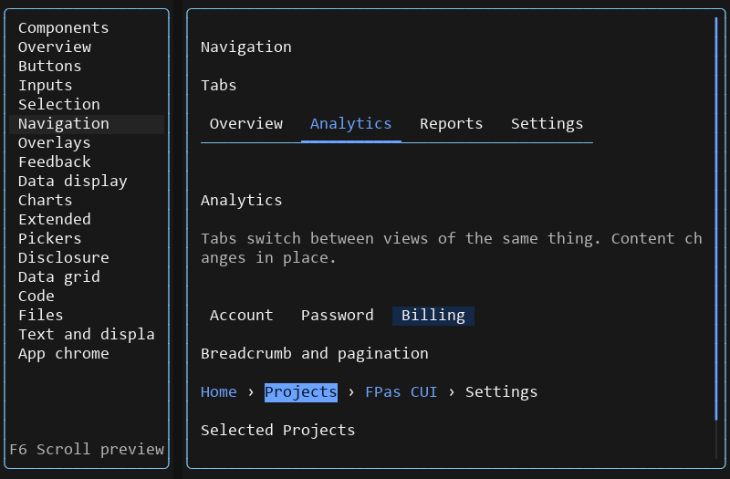

# Breadcrumb

Use `Fpas.Ui.Widgets.Navigation.Breadcrumbs.Breadcrumb` to show the current
location and offer links to its ancestors. The original CUI gallery example
under **Components → Navigation** shows **Home › Projects › FPas CUI › Settings**.

## Interaction

Tab or Shift+Tab visits enabled ancestor links. Enter, Space or a click
proposes the ancestor's zero-based position through `OnNavigate`. The final
caption shows the current location. Supply a new path from the application
model when navigation changes that location. The gallery displays the
activated caption beneath the example.

When space is tight, the trail keeps the current location and as many of
the nearest ancestors as fit. The **…** button opens the remaining ancestors
in their original order. Use Up or Down to highlight an item, then Enter,
Space or a click to select it. Escape closes the menu and restores focus
to **…**. Resizing moves focus from an omitted link to **…**, or back to a
visible ancestor when the menu button disappears.

## IDs and state

Use `Breadcrumbs.ItemId(Id, Index)` to identify a visible ancestor or an
ancestor in the open menu. Repeated captions keep their positional IDs.
The overflow button uses `<id>/overflow`. When visible, the last item has
snapshot value `current` and skips Tab. `Enabled := false` disables the links
and menu. The host shortens long captions at grapheme boundaries.

## See also

- [Navigation](README.md)
- [Shared API and CUI example](../../gui/navigation/breadcrumb.md)
- [Terminal gallery](../../../../examples/ui/tui/gallery/README.md)

## Source files

- [Terminal breadcrumb and overflow menu](../../../../src/Fpas.Ui.Tui/Internal/Widgets/Navigation/Breadcrumb.fpas)
- [Headless breadcrumb contract](../../../../tests/Fixtures/tui/Breadcrumb.fpas)
