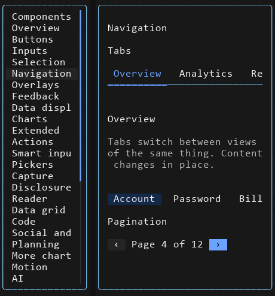

# Pagination

Use `Fpas.Ui.Widgets.Navigation.Paginations.Pagination` to navigate a
collection split into pages. **Components → Navigation → Pagination**
shows the same twelve-page sample in both galleries. The terminal gallery
allocates a compact row for Previous, the current page and Next.

## Interaction

Use Tab or Shift+Tab to focus an enabled button. Press Enter or Space or
click the button to request a page. Previous is disabled on the first page
and Next on the last. Activating the current number keeps the page selected.

The pager uses its allocated width to choose its display. It shows every
page for up to seven pages when room permits. Larger collections show the
first and last pages, a window around the current page and ellipses for
omitted pages. In compact mode, Previous and Next flank a current-page
indicator such as `Page 4 of 12`. The indicator shortens to `4/12` when
necessary. If a resize hides the focused page number, focus moves to an
available arrow. Reaching a boundary moves focus off the disabled arrow.

## Model and snapshots

Pass a positive page count and a valid zero-based page index. `OnChange`
receives the proposed zero-based index. Update the model to accept it and
render the content for that page. The visible page numbers start at one.
`Enabled := false` disables all navigation buttons.

The `pagination` snapshot at the pager ID reports the model's zero-based
page. Arrow controls use `<id>/previous` and `<id>/next`. A visible numbered
button uses `<id>/<index>` and reports selection as `true` or `false`.

## See also

- [Navigation](README.md)
- [Shared API and CUI example](../../gui/navigation/pagination.md)
- [Terminal gallery](../../../../examples/ui/tui/gallery/README.md)

## Source files

- [Numbered pages and their IDs](../../../../src/Fpas.Ui/Internal/Navigation/PaginationPages.fpas)
- [Terminal pager layout](../../../../src/Fpas.Ui.Tui/Internal/Widgets/Navigation/Pagination.fpas)
- [Headless pagination contract](../../../../tests/Fixtures/tui/Pagination.fpas)
