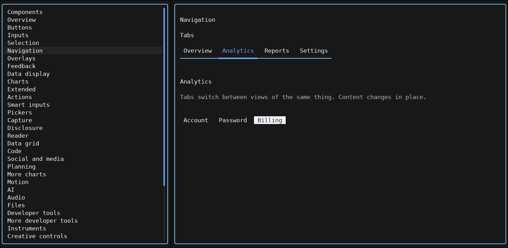

# Tabs

Tabs switch the content inside a page. Under **Components → Navigation → Tabs**, both galleries show an underline strip for **Overview**, **Analytics**, **Reports** and **Settings**, and a pill strip for **Account**, **Password** and **Billing**.



## Example

```pascal
unit Docs.Tui.Navigation.Tabs;

uses Fpas.Ui.Elements as E, Fpas.Ui.Widgets.Navigation.Tabs as Tabs;

// Builds the strip and the content chosen by the current model.
// ## Parameters
// - `Selected`: The selected zero-based index.
// ## Returns
// A tab strip followed by the content for the selected tab.
public function View(Selected: int): E.Element<int>;
begin
  return E.Column<int>(
    Tabs.Tabs<int>('sections', [new Tabs.Item('Overview'), new Tabs.Item('Reports')],
      Selected, function(Index: int): int => Index),
    E.Text<int>(if Selected = 0 then 'Project overview' else 'Project reports' end if)
  );
end function;

end unit;
```

## Interaction

Tab and Shift+Tab visit each strip once and enter at its selected tab. Left and Right move between tabs and stop at the ends. Home and End go to the first and last tab. These keys, a click, Enter or Space propose a selection. The model supplies the next displayed selection and content.

An overflowing strip scrolls horizontally to keep the focused tab visible. Use `Tabs.ItemId(Id, Index)` to focus or find a tab. Visible items have the snapshot role `tab` and their selection value is `true` or `false`. Disabled strips are skipped during keyboard traversal.

The underline appearance uses a separate line and the pill appearance uses the selected background. Both use text labels in the terminal. `FullWidth` distributes spare columns across the strip.

## See also

- [Navigation](README.md)
- [Tabs API and GUI example](../../gui/navigation/tabs.md)

## Source files

- [Terminal layout and interaction](../../../../src/Fpas.Ui.Tui/Internal/Widgets/Navigation/Tabs.fpas)
- [Terminal tabs contract](../../../../tests/Fixtures/tui/Tabs.fpas)
