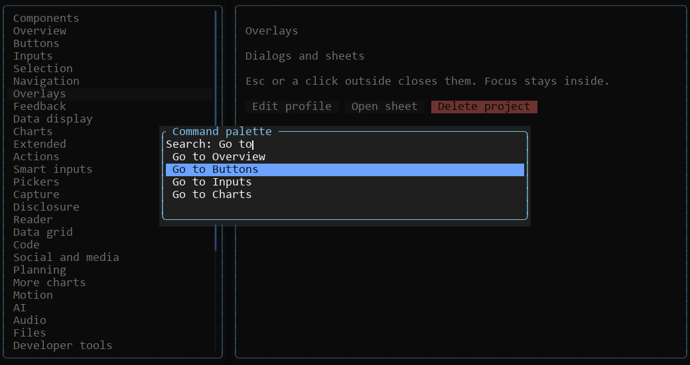

# Command palette

`Fpas.Ui.Widgets.Overlays.CommandPalettes.CommandPalette` offers searchable
commands over a base view. The TUI gallery opens it from **Components →
Overlays** and with **Ctrl+K**.

Type part of a command title to filter the results. Up and Down move the
highlight and Enter runs the command. Escape closes the palette and restores
focus when the underlying control is still present. Ctrl+K also closes an open
palette when `UseShortcut` is enabled. The application handles the visibility
proposal separately from the message sent by the chosen command. The terminal
shows the title and any shortcut hint supplied by the command.

## Source files

- [Terminal palette](../../../../src/Fpas.Ui.Tui/Internal/Widgets/Overlays/CommandPalette.fpas)
- [Graphical palette and shared API](../../gui/overlays/command-palette.md)
- [Gallery](../../../../examples/ui/tui/gallery/README.md)
