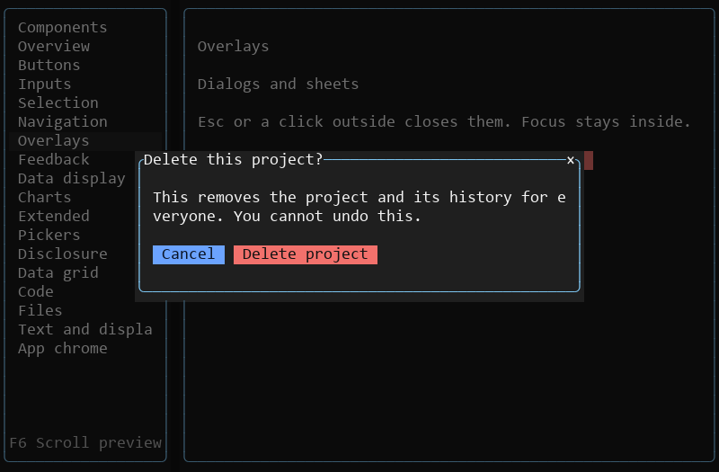

# Dialog

Center a short decision over the current view. The gallery asks before clearing the queue and initially focuses Cancel.



## Example

```pascal
unit Docs.Tui.Widgets.Dialog;

uses Fpas.Ui.Elements as E, Fpas.Ui.Widgets.Overlays.Dialogs as W, Fpas.Ui.Widgets.Actions.Buttons as B;

// Builds the dialog example.
// ## Parameters
// - `Base`: View below the overlay.
// - `Open`: Model-owned visibility.
// ## Returns
// The resulting view.
public function View(Base: E.Element<string>; Open: bool): E.Element<string>;
begin
  return W.Dialog<string>('clear-queue', Base,
    E.Column<string>(E.Text<string>('Remove the queued tracks?'),
      E.Row<string>(B.Button<string>('cancel', 'Cancel', 'close'), B.Button<string>('clear', 'Clear', 'clear'))),
    Open, new W.Options('Clear queue?', Width := 304, InitialFocus := 'cancel'), 'close');
end function;

end unit;
```

## Interaction

Tab stays inside the open dialog. Escape, the close button or a backdrop click sends the dismissal message. Set `Persistent` to keep the dialog open on Escape and backdrop clicks. Closing restores available focus. The dialog stays centered on resize and scrolls a long body.

## See also

- [Overlays](README.md)
- [Shared API](../../widgets.md#dialog-and-action-footer)
- [GUI dialog](../../gui/overlays/dialog.md)
- [Gallery source](../../../../examples/ui/tui/gallery/QueueSample.fpas)
