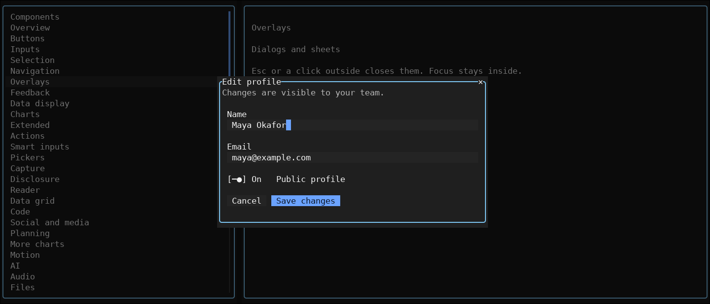

# Dialog

Center a short decision over the current view. Under **Components → Overlays → Dialogs and sheets**, **Delete project** initially focuses Cancel. **Edit profile** opens the shared name, email and Public profile switch.




## Example

```pascal
unit Docs.Tui.Widgets.Dialog;

uses Fpas.Ui.Elements as E;
uses Fpas.Ui.Widgets.Actions.Buttons as B;
uses Fpas.Ui.Widgets.Overlays.Dialogs as W;

// Builds the dialog example.
// ## Parameters
// - `Base`: View below the overlay.
// - `Open`: Model-owned visibility.
// ## Returns
// The resulting view.
public function View(Base: E.Element of string; Open: bool): E.Element of string;
begin
  return W.Dialog of string('delete-project', Base,
    E.Column of string(E.Text of string('This removes the project and its history for everyone. You cannot undo this.'),
      E.Row of string(B.Button of string('cancel', 'Cancel', 'close'), B.Button of string('delete', 'Delete project', 'delete'))),
    Open, new W.Options('Delete this project?', Width := 400, InitialFocus := 'cancel'), 'close');
end function;

end unit;
```

## Interaction

Tab stays inside the open dialog. Escape, the close button or a backdrop click sends the dismissal message. Set `Persistent` to keep the dialog open on Escape and backdrop clicks. Closing restores available focus. The dialog stays centered on resize and scrolls a long body.

## See also

- [Overlays](README.md)
- [Shared API](../../widgets.md#dialog-and-action-footer)
- [GUI dialog](../../gui/overlays/dialog.md)
- [Gallery source](../../../../examples/ui/tui/gallery/ProfileSample.fpas)
