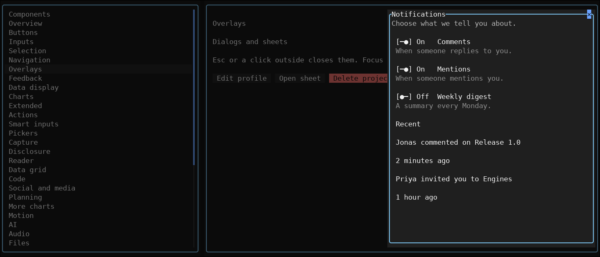

# Sheet and drawer

Dock a secondary view to an edge while retaining the current page in the background. Under **Components → Overlays → Dialogs and sheets**, **Open sheet** shows the Notifications example. The Comments, Mentions and Weekly digest [switches](../selection/switch.md) appear above the recent activity.



## Example

```pascal
unit Docs.Tui.Widgets.Sheet;

uses Fpas.Ui.Elements as E, Fpas.Ui.Widgets.Overlays.Sheets as W;

// Builds the sheet and drawer example.
// ## Parameters
// - `Base`: View below the overlay.
// - `Open`: Model-owned visibility.
// ## Returns
// The resulting view.
public function View(Base: E.Element<string>; Open: bool): E.Element<string>;
begin
  return W.Sheet<string>('sheet', Base,
    E.Column<string>(E.Text<string>('Recent'), E.Text<string>('Jonas commented on Release 1.0')),
    Open, new W.Options('Notifications', Description := 'Choose what we tell you about.'), 'close');
end function;

end unit;
```

## Interaction

The edge defaults to Right. Size sets the width for a side sheet or height for a top or bottom sheet. Tab stays in the sheet. Page Up and Page Down scroll the body while the header remains visible. Escape or a backdrop click proposes dismissal.

## See also

- [Overlays](README.md)
- [Shared API](../../widgets.md#sheet-and-drawer)
- [GUI sheet and drawer](../../gui/overlays/sheet.md)
- [Gallery source](../../../../examples/ui/tui/gallery/ProfileSample.fpas)
