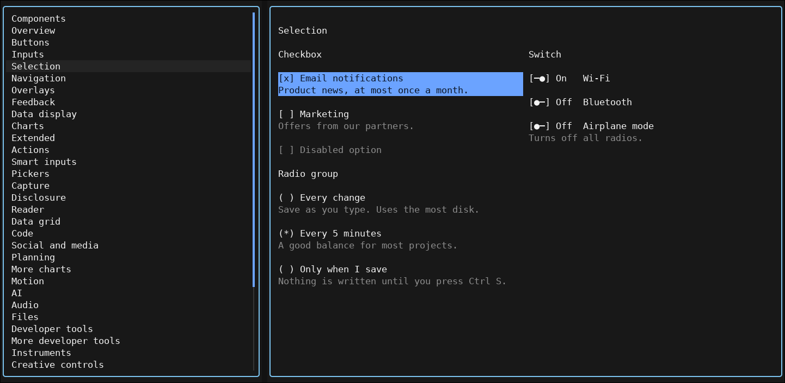

# Checkbox

Use a checkbox for an independent option. **Components → Selection → Checkbox** shows Email notifications, Marketing and Disabled option. In **Overview → Create a workspace**, the weekly summary is a separate preference.



## Example

```pascal
unit Docs.Tui.Selection.Checkbox;

uses Fpas.Ui.Elements as E, Fpas.Ui.Widgets.Inputs.Checkboxes as C;

// Displays whether any or all items in a group are selected.
// ## Parameters
// - `AnySelected`: At least one item is selected.
// - `AllSelected`: Every item is selected.
// ## Returns
// A checkbox that proposes selecting or clearing the group.
public function View(AnySelected: bool; AllSelected: bool): E.Element<bool>;
begin
  return C.Checkbox<bool>('all', 'All items', AnySelected, function(Value: bool): bool => Value,
    Indeterminate := AnySelected and not AllSelected);
end function;

end unit;
```

## Interaction

Tab to an enabled checkbox, then press Space or Enter. Clicking the caption, marker or description has the same effect. The callback proposes the opposite of `Checked`. The model supplies the next displayed value.

| Display | Model | Snapshot value |
| --- | --- | --- |
| `[ ]` | `Checked = false` | `false` |
| `[x]` | Checked | `true` |
| `[-]` | Checked and indeterminate | `mixed` |

Activating a mixed checkbox proposes `false`. With `HideLabel := true`, only the three-cell marker is visible and clickable. The snapshot retains the accessible label. Disabled options skip keyboard focus and ignore activation.

## See also

- [Selection](README.md)
- [Checkbox API and GUI example](../../gui/selection/checkbox.md)
- [Workspace form in the terminal gallery](../../../../examples/ui/tui/gallery/workspace.png)

## Source files

- [Terminal checkbox contract](../../../../tests/Fixtures/tui/Checkbox.fpas)
