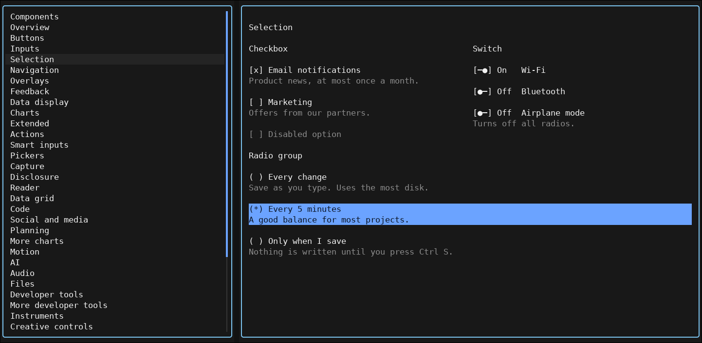

# Radio group

Use a radio group when choosing one option replaces the previous choice. Both galleries show the save-frequency example under **Components → Selection → Radio group**.



## Example

```pascal
unit Docs.Tui.Selection.RadioGroup;

uses Fpas.Ui.Elements as E;
uses Fpas.Ui.Widgets.Inputs.RadioGroups as R;

// Builds the save-frequency control.
// ## Parameters
// - `Selected`: Current choice index, or -1 for no selection.
// ## Returns
// A control that sends the proposed index to the update function.
public function View(Selected: int): E.Element<int>;
begin
  return R.RadioGroup<int>('save-frequency', [
    new R.Item('Every change'),
    new R.Item('Every 5 minutes', 'A good balance for most projects.'),
    new R.Item('Only when I save')
  ], Selected, function(Index: int): int => Index);
end function;

end unit;
```

## Interaction

Tab and Shift+Tab visit the group once. Focus enters on the selected row if it is enabled, otherwise on the first enabled row. Entering the group preserves the model’s selection. Disabled groups and groups with no enabled choices are skipped.

Up and Left propose the previous enabled choice. Down and Right propose the next. Both directions wrap at the ends. Space, Enter or a click on the marker, label or description proposes that row. Activating the selected choice sends no message.

The selected row shows `(*)` and the others show `( )`. Each row has the snapshot role `radio` and value `true` or `false`. Use `R.ItemId('save-frequency', Index)` to inspect or focus it.

## See also

- [Selection](README.md)
- [Radio group API and GUI example](../../gui/selection/radio-group.md)

## Source files

- [Terminal radio group](../../../../src/Fpas.Ui.Tui/Internal/Widgets/Inputs/RadioGroup.fpas)
- [Keyboard, pointer and scrolling contract](../../../../tests/Fixtures/tui/RadioGroup.fpas)
