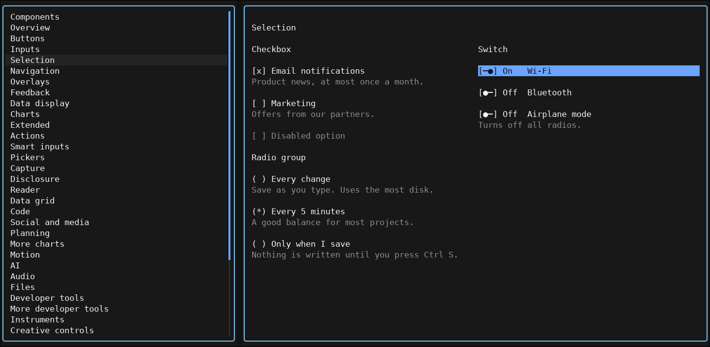

# Switch

Use a switch for a setting with two states. Open **Components → Selection → Switch** in the terminal gallery to try Wi-Fi, Bluetooth and Airplane mode.



## Example

```pascal
unit Docs.Tui.Selection.Switch;

uses Fpas.Ui.Elements as E;
uses Fpas.Ui.Widgets.Inputs.Switches as S;

// Builds the Wi-Fi setting.
// ## Parameters
// - `On`: Current setting from the application model.
// ## Returns
// A switch that proposes a new Boolean value on activation.
public function View(On: bool): E.Element of bool;
begin
  return S.Switch of bool('wifi', 'Wi-Fi', On, function(Value: bool): bool => Value);
end function;

end unit;
```

## Interaction

Tab to the switch and press Space or Enter, or click anywhere on its row, including the optional description. The marker changes position and the caption reads **On** or **Off**. The callback proposes the opposite of the displayed value. The model supplies the value for the next frame. Disabled switches skip focus and ignore input.

The gallery shares Wi-Fi with **Edit profile → Public profile** and **Notifications → Mentions**. Bluetooth and **Notifications → Weekly digest** also share a value. Comments uses the Email notifications checkbox value. Airplane mode has its own value.

## See also

- [Selection](README.md)
- [Switch API and GUI example](../../gui/selection/switch.md)
- [Shared widget contract](../../widgets.md#checkbox-switch-and-radio-controls)
- [Terminal checkbox and switch rows](../../../../src/Fpas.Ui.Tui/Internal/Widgets/Inputs/ToggleRows.fpas)
