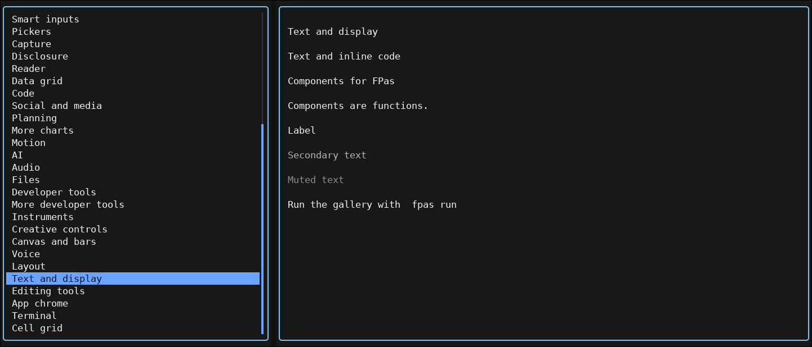

# Text

Use text, semantic roles and a column to distinguish a heading, body copy and a caption. The terminal wraps at grapheme boundaries.



## Example

```pascal
unit Docs.Tui.Widgets.Text;

uses Fpas.Ui.Elements as E, Fpas.Ui.Styles as S, Fpas.Ui.Layout as L;

// Builds the text example.
// ## Returns
// The resulting view.
public function View(): E.Element<string>;
begin
  return E.Column<string>(new L.Flow(Gap := L.Spacing.Normal),
    E.Styled<string>(E.Text<string>('Components for FPas'), S.Role.Heading),
    E.Text<string>('Components are functions.'),
    E.Styled<string>(E.Text<string>('Muted text'), S.Role.Muted));
end function;

end unit;
```

## Interaction

Text is passive. Resize the terminal to change the line breaks. Use semantic roles for text that should follow a theme change. For editable content use a [text field](../inputs/text-field.md).

## See also

- [Text and display](README.md)
- [Shared API](../../widgets.md#layout-and-style)
- [GUI text](../../gui/text-and-display/text.md)
- [Gallery source](../../../../examples/ui/tui/gallery/main.fpas)

## Source files

- [Glyphs.fpas](../../../../src/Fpas.Ui.Tui/Internal/Rendering/Glyphs.fpas)
