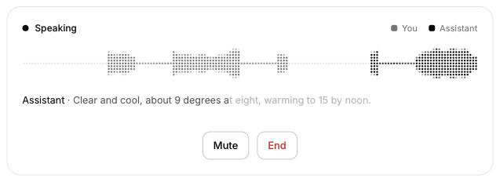

# Voice session

The gallery displays both voices on one timeline with a scripted transcript.
The timeline stays flat during the thinking pause.
Available in **GUI**.



## Example

```pascal
unit Docs.Ui.Voice.VoiceSession;

uses Fpas.Ui.Elements as E, Fpas.Ui.Widgets.Audio.VoiceSessions as W, Fpas.Ui.Widgets.Audio.Voice as V;

// Shows an active conversation and its latest transcript.
// ## Parameters
// - `Mode`: Current activity, such as Listening or Speaking.
// - `Signal`: Recent audio levels and optional speaker tags.
// - `Muted`: Current microphone state.
// - `Spoken`: Words spoken so far.
// ## Returns
// The session with mute and end-call proposals.
public function View(Mode: V.Activity; Signal: V.Signal; Muted: bool; Spoken: string): E.Element<W.Event>;
begin
  return W.VoiceSession<W.Event>('call', Mode, Signal, Muted,
    function(Change: W.Event): W.Event => Change, new W.Options(Transcript := Spoken));
end function;

end unit;
```

## Options and defaults

| Option | Default or requirement |
| --- | --- |
| `Activity / Signal` | Supply the current activity and recent levels, with one speaker tag per level when tags are present. |
| `Muted / HideEnd / Enabled` | Pass null Muted to omit that button. HideEnd defaults to false and Enabled to true. |
| `Label / You / Assistant` | All empty. Supply display labels to override native text. |
| `Transcript / Upcoming / Speaker` | null / null / You. Supply spoken and upcoming text and the speaker for that text. |

## Interaction

Update the signal and transcript as the conversation advances. Handle
`Mute` and `EndCall` in the application. Use `Voice.Silent` in the
signal to represent a quiet interval.

## See also

- [Widget API and types](../../../src/Fpas.Ui/Widgets/Audio/VoiceSessions.fpas)
- [Gallery example](../../../examples/ui/gui/gallery/Pages/Voice/View.fpas)
- [Voice waveform](voice-waveform.md)
- [Gallery voice script](../../../examples/ui/gui/gallery/Pages/Voice/Script.fpas)
- [Voice](README.md)
