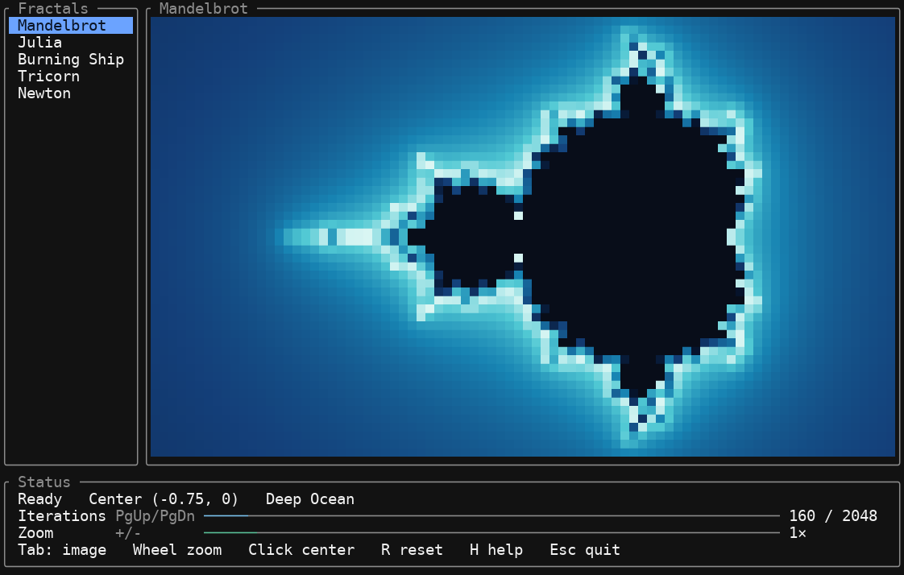

# TUI fractal explorer

Explore Mandelbrot, Julia, Burning Ship, Tricorn and the Newton basins of
`z³ − 1`. The framed status panel shows the complex-plane center, palette,
iteration limit, magnification and render state. Julia also shows its constant.
Selecting a different family opens its initial view.



| Input | Action |
| --- | --- |
| ↑ / ↓, Enter in the list | Browse and select a fractal |
| Tab / Shift+Tab | Move between the list and image |
| Arrows in the image | Pan |
| Left click in the image | Center on the clicked cell |
| Wheel / + / − | Zoom at the pointer / zoom at the center |
| Page Up / Page Down in the image | Raise or lower the iteration limit by 32 |
| 1 / 2 / 3 | Select Deep Ocean, Ember or Aurora for escape-time fractals |
| W / A / S / D in Julia | Adjust the imaginary or real component of the constant |
| R / middle click | Reset the current fractal |
| H / Esc | Open help / dismiss help or quit |

Each cell shows two vertical samples. Camera and size changes replace the
running background render. Only completed frames reach the terminal.

After the [local SDK bootstrap](../../../../docs/build/development.md#build-an-fpas-application),
run from the repository root.

```sh
dotnet run --project examples/ui/tui/fractals/FractalExplorer.fpasproj
```

## Source files

- `examples/ui/tui/fractals/`
  - [Camera.fpas](Camera.fpas)
  - [Explorer.fpas](Explorer.fpas)
  - [FractalExplorer.fpasproj](FractalExplorer.fpasproj)
  - [Rendering.fpas](Rendering.fpas)
  - [View.fpas](View.fpas)
  - [main.fpas](main.fpas)
- `tests/Fixtures/tui/`
  - [FractalExplorer.fpas](../../../../tests/Fixtures/tui/FractalExplorer.fpas)
