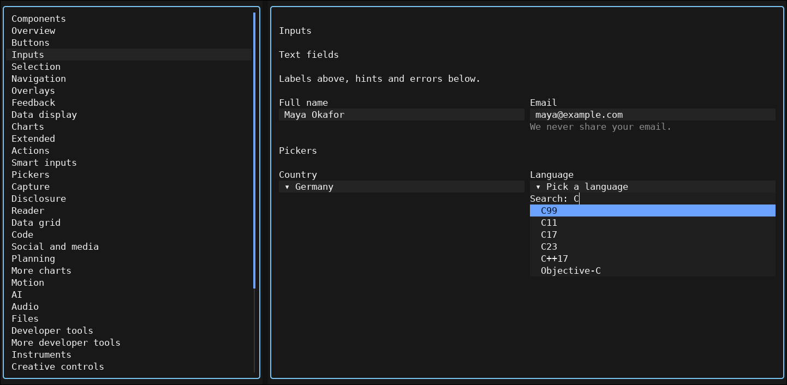
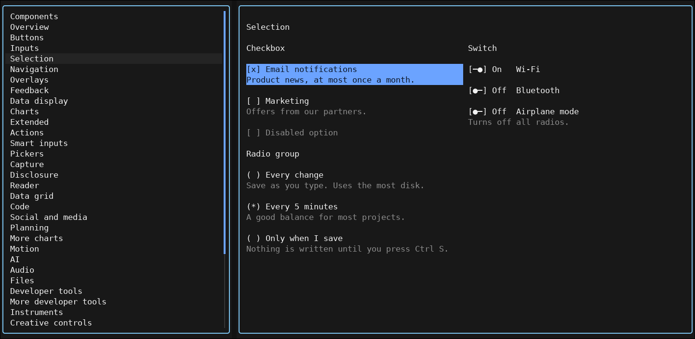
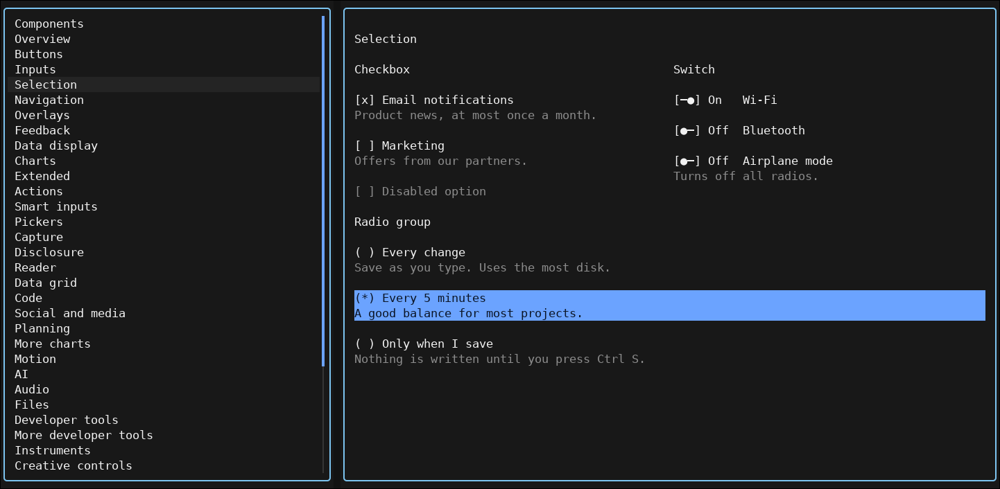
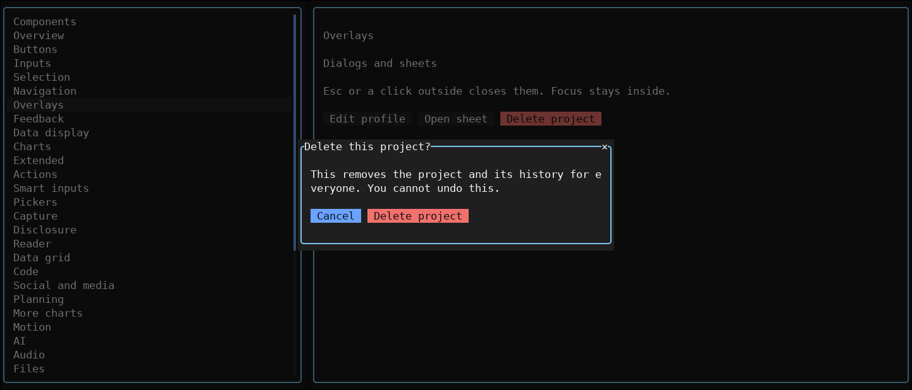

# TUI gallery

[Illustrated TUI widget guide](../../../../docs/ui/tui/README.md)

The sidebar follows the GUI gallery’s **Components** and **Extended** sections in the same order. The preview shows the examples supported by the terminal. Destinations without a terminal example show a short description.

| Gallery destination | Terminal example |
| --- | --- |
| Components → Overview | Browse components or create a workspace with the shared name and email fields and an optional weekly summary. |
| Components → Buttons | Variants, sizes and icons, then states. Choose **Save changes** to see **Saving**, or **Reset** to return to the initial state. |
| Components → Inputs | Edit the full name and email side by side or stacked on narrow terminals. Overview and the profile dialog show the same values. |
| Components → Inputs → Pickers | Choose a country or filter languages by typing in the open list. |
| Components → Selection → Checkbox | Email notifications, Marketing and a disabled option. Email notifications also controls Comments in the Notifications sheet. |
| Components → Selection → Switch | Toggle Wi-Fi, Bluetooth or Airplane mode. Wi-Fi and Bluetooth also control the corresponding preferences in Overlays. |
| Components → Selection → Radio group | Choose how often to save with the arrow keys or a click. |
| Components → Overlays | Edit the profile, open the Notifications sheet, or confirm project deletion. The sheet has three editable notification switches and two recent events. |
| Components → Feedback → Progress | Uploading assets at 68% and exporting a clip at 42%. |
| Components → Data display → Table | The five people from the GUI example, with the same columns, sort order and initial selection. |
| Extended → Text and display → Text and inline code | Heading, body, label, secondary text, muted text and a command. |
| Extended → App chrome | Editor excerpt and status bar. Activate the indentation, encoding or language to cycle its value. |
| Terminal → Cell grid | Click the ripple field to move its center or use the wheel to change its spacing. |

The sidebar and preview share the terminal width in a 1:2 ratio. Use ↑/↓, Page Up/Page Down or Home/End to navigate. Enter, Space or a click opens a destination. → focuses the first preview control and Tab moves between controls. Escape closes the current overlay or returns focus to the sidebar. In the table, ↑/↓ moves between people and Enter selects the focused row. Click or activate a sortable heading to change the order. Ctrl+T switches themes and Ctrl+Q exits.












After the [local SDK bootstrap](../../../../docs/build/development.md#build-an-fpas-application),
build and run the gallery from the repository root.

```sh
dotnet build examples/ui/tui/gallery/TuiWidgetGallery.fpasproj
dotnet examples/ui/tui/gallery/bin/Debug/net10.0/TuiWidgetGallery.dll
```

The gallery supports the [private debug terminal](../../../../docs/pascal/tools/debugging.md#private-terminal-and-tui-control).
For headless stepping, launch it with `--headless-control` and set
`FPAS_TUI_CONTROL_PIPE` to the controller's current-user pipe named
`fpas-tui-<32 hex digits>`. The initial frame is 80 × 24 cells.

## Source files

- [Catalog.fpas](Catalog.fpas)
- [TuiWidgetGallery.fpasproj](TuiWidgetGallery.fpasproj)
- [main.fpas](main.fpas)
