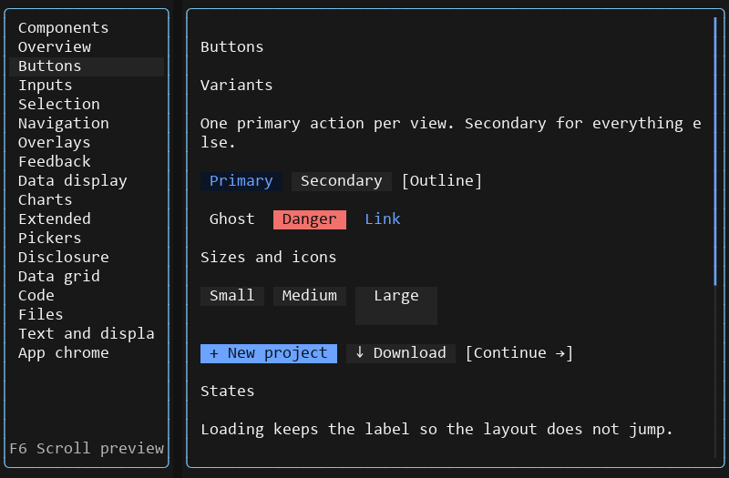
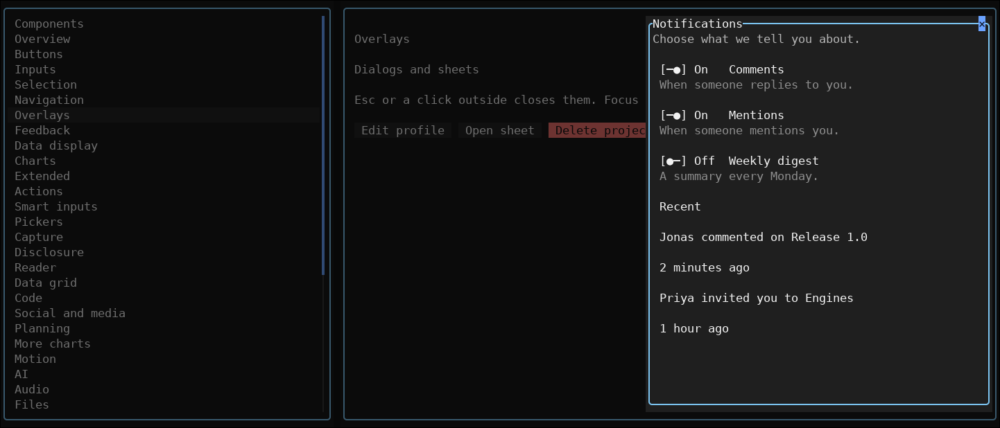
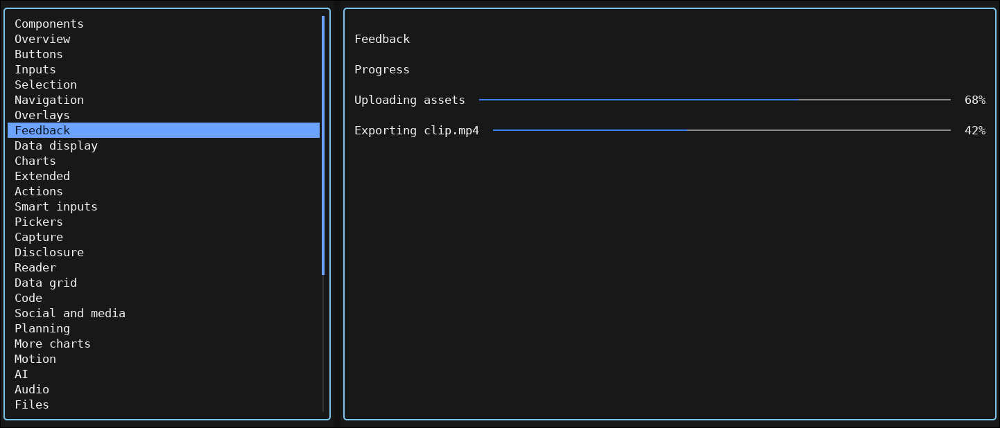
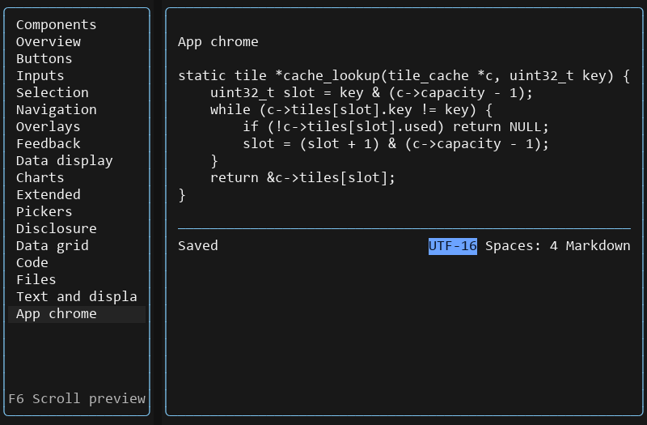

# TUI gallery

[Illustrated TUI widget guide](../../../../docs/ui/tui/README.md)

The left panel lists the GUI gallery's Components and Extended destinations plus
**Progress bar**, **Text** and **Cell grid**. The right panel previews the selected entry.
**Components → Inputs** and **Buttons** share a three-track play queue. Enter a
track title and press Enter or choose **Add track**. **Remove last** takes the
most recently added title off the queue. **Components → Overlays** shows the same queue in a right-hand sheet
or asks for confirmation before clearing it in a centered dialog.
**Components → Feedback** shows upload and export progress as colored lines with
percentages. **Extended → App chrome** places the status bar at the bottom of
the preview. Click the encoding or focus it and press Enter to switch between
UTF-8 and UTF-16. Text shows a heading,
wrapping body text and muted caption. Cell grid draws colored ripples. Click a cell
with the left or middle button to move their center, or use the wheel to change
their spacing. The footer shows the grid size and the last local input. Resizing
the terminal redraws the field. Other categories give a short description.
The panels share the terminal width in a 1:2 ratio with a one-cell gap.

Use ↑/↓, Page Up/Page Down or Home/End to move through the list. Enter, Space
or a mouse click opens the destination. The wheel scrolls the list. On Overview,
Feedback and Progress bar, ←/→ changes the sample by ten percentage points.
On Inputs, Buttons and Overlays, → moves into the preview. In the title field
←/→ moves the caret, Home/End jumps to either end and Escape returns to the
selected sidebar entry. Tab moves between controls. Escape closes an overlay.
Ctrl+T switches themes and Ctrl+Q exits.











After the [local SDK bootstrap](../../../../docs/build/development.md#build-an-fpas-application),
build and run the gallery from the repository root.

```sh
dotnet build examples/ui/tui/gallery/TuiWidgetGallery.fpasproj
dotnet examples/ui/tui/gallery/bin/Debug/net10.0/TuiWidgetGallery.dll
```

The gallery supports the [private debug terminal](../../../../docs/pascal/tools/debugging.md#private-terminal-and-tui-control).
For headless stepping, launch it with `--headless-control` and set
`FPAS_TUI_CONTROL_PIPE` to the controller's current-user pipe named
`fpas-tui-<32 hex digits>`. The initial frame is 80 × 24 cells.

## Source files

- [Catalog.fpas](Catalog.fpas)
- [TuiWidgetGallery.fpasproj](TuiWidgetGallery.fpasproj)
- [main.fpas](main.fpas)
