# TUI gallery

[Illustrated TUI widget guide](../../../../docs/ui/tui/README.md)

The sidebar follows the GUI gallery’s **Components** and **Extended** sections in the same order. The preview shows the examples supported by the terminal. Destinations without a terminal example show a short description.

Use the CUI gallery's sample data when demonstrating a CUI widget in the terminal. Adapt the layout and input to suit the terminal.

| Gallery destination | Terminal example |
| --- | --- |
| Components → Overview | Browse components or create a workspace with the shared name and email fields and an optional weekly summary. |
| Components → Buttons | Variants, sizes and icons, then states. Choose **Save changes** to see **Saving**, or **Reset** to return to the initial state. |
| Components → Buttons → Dropdown menu | Open Options to run a project command or confirm deletion. |
| Components → Buttons → [Segmented control](../../../../docs/ui/tui/actions/segmented-control.md) | Choose a view or date range from the original CUI examples. |
| Components → Inputs | Edit the full name and email side by side or stacked on narrow terminals. Overview and the profile dialog show the same values. |
| Components → Inputs → About | Edit the same multiline profile description as in the GUI. |
| Components → Inputs → [Search field](../../../../docs/ui/tui/inputs/search-field.md) | Edit and clear the original Search projects query. |
| Components → Inputs → Pickers | Choose a country, filter languages or adjust the original [Seats](../../../../docs/ui/tui/inputs/number-field.md) value. |
| Components → Selection → Checkbox | Email notifications, Marketing and a disabled option. Email notifications also controls Comments in the Notifications sheet. |
| Components → Selection → Switch | Toggle Wi-Fi, Bluetooth or Airplane mode. Wi-Fi and Bluetooth also control the corresponding preferences in Overlays. |
| Components → Selection → Radio group | Choose how often to save with the arrow keys or a click. |
| Components → Navigation → Tabs | Switch the underline and pill tabs from the GUI example. |
| Components → Navigation → [Breadcrumb](../../../../docs/ui/tui/navigation/breadcrumb.md) | Open an ancestor from the original CUI path. The overflow menu keeps hidden ancestors reachable. |
| Components → Navigation → [Pagination](../../../../docs/ui/tui/navigation/pagination.md) | Browse the original twelve-page example. Narrow previews keep Previous, the current page and Next. |
| Components → Overlays | Edit the profile, open the Notifications sheet, or confirm project deletion. The sheet has three editable notification switches and two recent events. |
| Components → Feedback → Progress | Uploading assets at 68% and exporting a clip at 42%. |
| Components → Feedback → [Alerts](../../../../docs/ui/tui/feedback/alert.md) | View the original four alerts and dismiss the storage warning. |
| Components → Feedback → [Spinners](../../../../docs/ui/tui/feedback/spinner.md) | View the original sizes, activity styles and inline loading examples. |
| Components → Charts → [Sparkline](../../../../docs/ui/tui/charts/sparkline.md) | Compare the original CUI sample values at natural and expanded widths. |
| Components → Data display → [Table](../../../../docs/ui/tui/data-display/table.md) | Browse and sort the five people from the GUI example. Focus a row and press Ctrl+Left or Ctrl+Right to see hidden columns on a narrow terminal. |
| Components → Data display → [List](../../../../docs/ui/tui/data-display/selection-list.md) | Browse Design review, Release 1.0, and Planning from the CUI gallery. Use Enter to open the selected row. |
| Components → Data display → [Tree view](../../../../docs/ui/tui/data-display/tree.md) | Expand the same source folders and activate files from the CUI example. |
| Components → Overlays → [Command palette](../../../../docs/ui/tui/overlays/command-palette.md) | Open with Ctrl+K, type to filter gallery actions, and press Enter to run the highlighted action. |
| Extended → Pickers → [Multi-select](../../../../docs/ui/tui/inputs/multi-select.md) | Search and toggle languages in the original CUI checklist. |
| Extended → Actions → [Toggle group](../../../../docs/ui/tui/actions/toggle-group.md) | Toggle independent formatting or choose a single alignment. |
| Extended → Data grid → [Filter bar](../../../../docs/ui/tui/data-display/filter-bar.md) | Search and choose several Team, Status or Role values using the original CUI fields. |
| Extended → Code → [Log console](../../../../docs/ui/tui/developer/log-console.md) | Browse the CUI gallery's build log and reveal its next entry. Press End in the log to resume following new entries. |
| Extended → Files → [File picker](../../../../docs/ui/tui/files/file-picker.md) | Open a file or enter a save name using the original CUI examples. |
| Extended → Disclosure → Expandable cards | Open Security to read the recovery-code details. |
| Extended → Text and display → Text and inline code | Heading, body, label, secondary text, muted text and a command. |
| Extended → App chrome | Editor excerpt and status bar. Activate the indentation, encoding or language to cycle its value. |
| Terminal → Cell grid | Click the ripple field to move its center or use the wheel to change its spacing. |

The sidebar and preview share the terminal width in a 1:2 ratio. Use ↑/↓, Page Up/Page Down or Home/End to navigate. Enter, Space or a click opens a destination. → focuses the first preview control and Tab moves between controls. Escape closes the current overlay or returns focus to the sidebar. In the table, ↑/↓ moves between people and Enter selects the focused row. Click or activate a sortable heading to change the order. Ctrl+T switches themes and Ctrl+Q exits.

The gallery uses the terminal process's UI culture. Its navigation, descriptions
and controls use the GUI gallery's shared [English](../../gui/gallery/Shared/Strings.resx)
and [German](../../gui/gallery/Shared/Strings.de.resx) catalogs. On Linux, launch
it with `LANG=de_DE.UTF-8` for German.


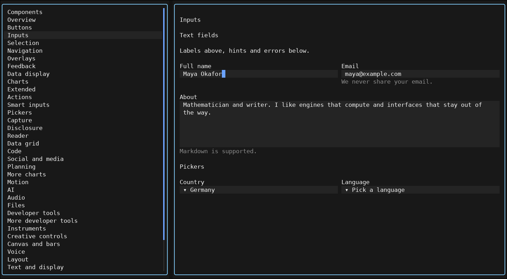


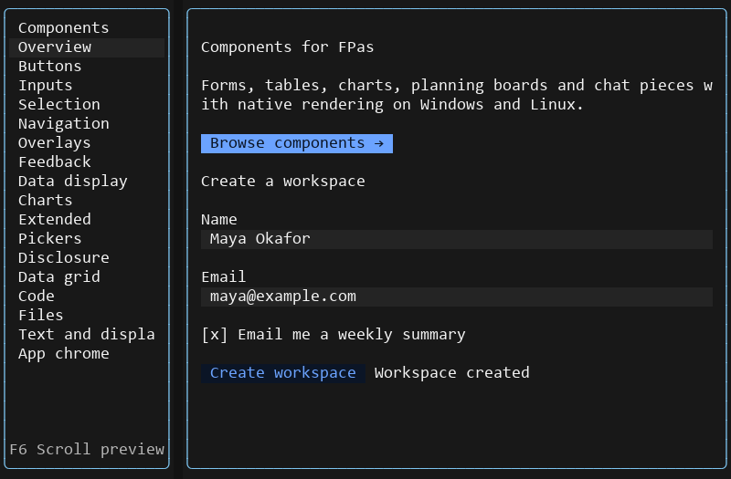


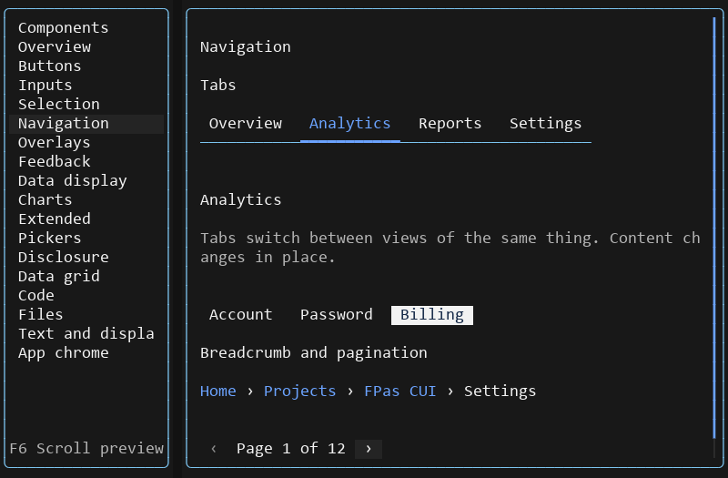


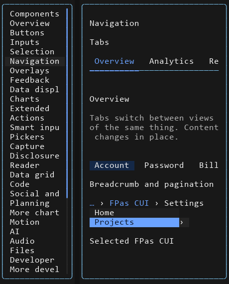

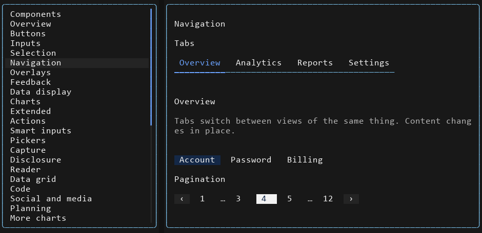


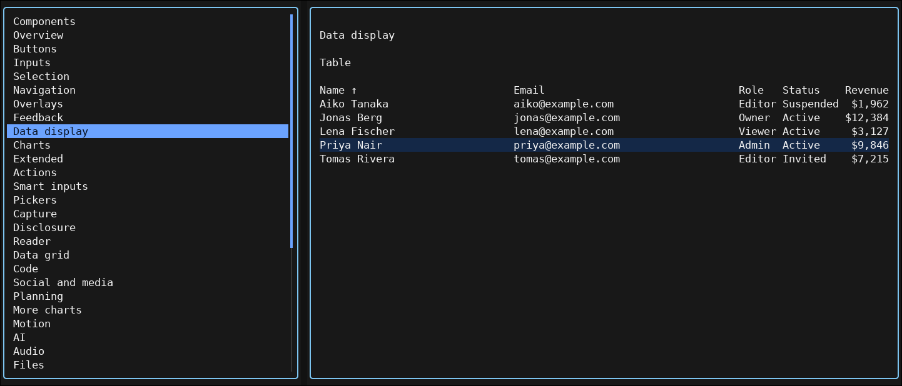

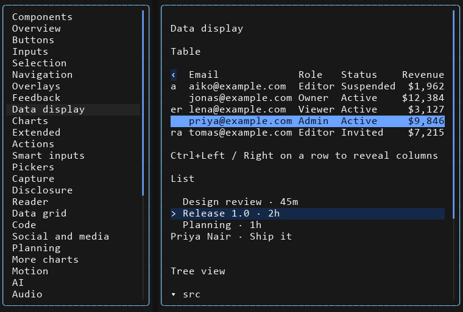

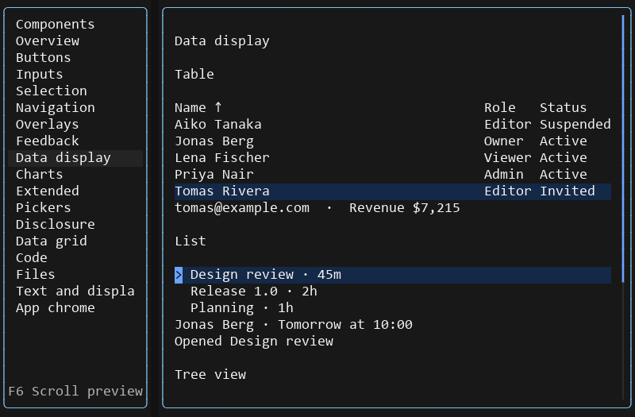


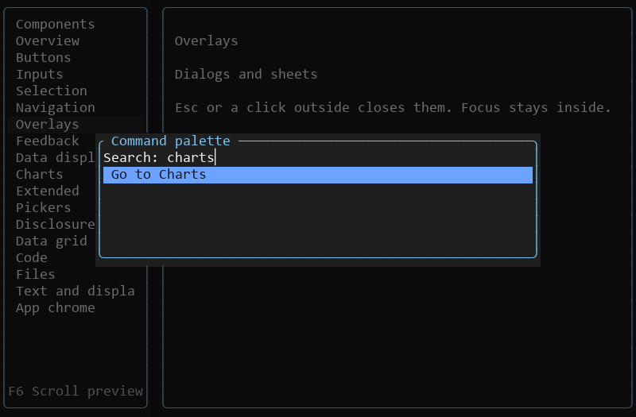

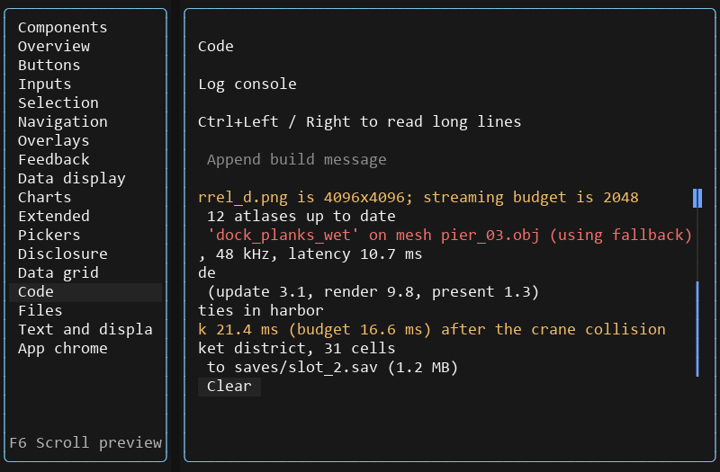

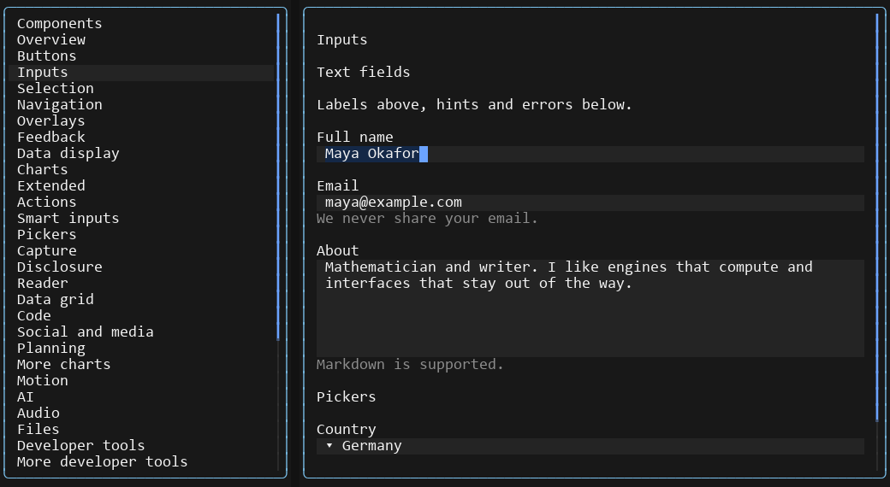


## File picker

Choose **Files** in **Extended**. Use **Open** to browse the sample entries
or **Save as** to edit the original default filename `untitled.txt`.
The view reports the confirmed path.


## Run the gallery

After the [local SDK bootstrap](../../../../docs/build/development.md#build-an-fpas-application),
build and run the gallery from the repository root.

```sh
dotnet build examples/ui/tui/gallery/TuiWidgetGallery.fpasproj
dotnet examples/ui/tui/gallery/bin/Debug/net10.0/TuiWidgetGallery.dll
```

The gallery supports the [private debug terminal](../../../../docs/pascal/tools/debugging.md#private-terminal-and-tui-control).
For headless stepping, launch it with `--headless-control` and set
`FPAS_TUI_CONTROL_PIPE` to the controller's current-user pipe named
`fpas-tui-<32 hex digits>`. The initial frame is 80 × 24 cells.

## Source files

- [AlertSamples.fpas](AlertSamples.fpas)
- [Catalog.fpas](Catalog.fpas)
- [ChoiceSamples.fpas](ChoiceSamples.fpas)
- [FilePickerSample.fpas](FilePickerSample.fpas)
- [InputSamples.fpas](InputSamples.fpas)
- [PlotSamples.fpas](PlotSamples.fpas)
- [State.fpas](State.fpas)
- [ToolSamples.fpas](ToolSamples.fpas)
- [TuiWidgetGallery.fpasproj](TuiWidgetGallery.fpasproj)
- [main.fpas](main.fpas)
